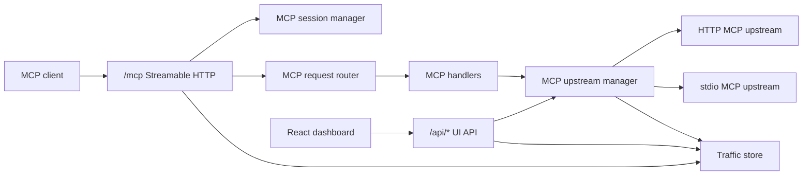

# aawa-mcpx design

This document describes architecture, protocol state, and validation boundaries.
[README.md](README.md) covers setup and operations. Bun exposes one Streamable HTTP
endpoint aggregating tools, prompts, and resources from HTTP/stdio MCP backends.

## Contents

- [1. Main concepts](#1-main-concepts)
- [2. Runtime architecture](#2-runtime-architecture)
- [3. MCP protocol model](#3-mcp-protocol-model)
- [4. Persistence](#4-persistence)
- [5. Validation policy](#5-validation-policy)
- [6. Open considerations](#6-open-considerations)
- [7. References](#7-references)

## 1. Main concepts

| Term | Meaning |
| --- | --- |
| Gateway | Bun server and public HTTP surface. |
| JSON-RPC message | Request, notification, or response; distinct from an HTTP request/response. |
| MCP client | External client using `/mcp`. |
| MCP upstream | Configured backend MCP server. |
| UI | React dashboard served by the gateway. |
| UI API | Dashboard HTTP API under `/api/*`, separate from MCP routes. |

## 2. Runtime architecture

Figure ARCH-01: Request paths from MCP clients and the dashboard to upstreams and traffic storage.

### 2.1 Source responsibilities

Paths are relative to `src/`. Server code never imports UI implementations;
the UI uses only UI-local modules and browser-safe `shared/` contracts.

| Layer | Modules and responsibilities |
| --- | --- |
| `config/` | Load, validate, and persist configuration. |
| `gateway/` | `server.ts`: `Bun.serve`/route wiring; `mcp_http_route.ts`: HTTP handling; `mcp_request_router.ts`: JSON-RPC dispatch/version adaptation. |
| | `mcp_session.ts`: public initialization/sessions; `client_activity.ts`: dashboard history; `mcp_handlers.ts`: upstream operations; `mcp_namespaces.ts`: namespacing; `ui_routes.ts`: UI APIs/events. |
| `mcp_upstreams/` | `manager.ts`: stable gateway API/service wiring; `connections.ts`: connection/recovery lifecycle; `health_checks.ts`: probes; `catalog.ts`: caches/exposure state. |
| | `method_calls.ts`: calls/argument validation; `protocol_client.ts`: JSON-RPC, revision selection, HTTP/SSE and stdio; `tool_result.ts`: structured recovery/duplicate removal; `input_schema.ts`/`output_schema.ts`: provider schema policies; `json_schema.ts`: shared compiler; `types.d.ts`: manager contracts. |
| `server/` | Server-only infrastructure, including SQLite traffic storage. |
| `shared/` | `ui_api.ts`: dashboard contracts; `mcp_schemas.ts`: MCP validators; `mcp_results.ts`: result types; `mcp_output_schema.ts`: legacy wrappers; `common.ts`: cross-runtime helpers. |
| `ui/` | `main.tsx`: entrypoint from `index.html`; `App.tsx`: state/routing; `base_components/`: low-level components; `components/`: app components; `sections/`: pages; `i18n/` and `styles/`: assets. |

The compact footer links `© [current year] Aawa Technologies / Mikael Nakajima`
to [Aawa Technologies](https://aawa.jp). The SDK supplies types, not client/server implementations.

### 2.2 Connection lifecycle

Probes run independently for enabled, connected backends after catalog refresh.
Disable/reconnect invalidates stale results. Transport failures retire the client
and schedule recovery without replaying operations; negotiation failures stop
retries until disable/re-enable.

Reconnects share one attempt per backend/connection epoch. Reconnection and catalog
refresh reset backoff; shutdown invalidates epochs and cancels clients/timers.
[Network recovery](README.md#network-recovery) specifies timing and thresholds.
Backoff follows [AWS retry guidance](https://docs.aws.amazon.com/sdkref/latest/guide/feature-retry-behavior.html).

## 3. MCP protocol model

### 3.1 Versions, transport, and catalogs

`shared/mcp_protocol.ts` is the ordered revision registry;
`CURRENT_PROTOCOL_VERSION` is its newest entry. Backend selections survive
connection epochs/toggles until restart. Reinitialization of 2025 backends verifies
the retained revision. Unsupported initialization proposals select `2025-11-25`,
the highest supported revision requiring initialization.

Public `POST /mcp` returns JSON-RPC over JSON. Required 2025 notifications/responses
receive HTTP 202 without a body. The 2026 path uses discovery, per-request metadata,
mirrored-header validation, and complete-result/cache fields; removed methods
return HTTP 404 with JSON-RPC method-not-found. A supplied `MCP-Protocol-Version`
must match metadata (2026) or the session (2025). Present `Origin` headers are
validated to reduce DNS rebinding risk.

Public GET event streams, SSE POST responses, and stdio are not exposed: the
gateway sends no server-initiated MCP messages and completes operations with one
JSON response. Backend HTTP accepts JSON/SSE; backend stdio is supported.
See [feature scope](README.md#protocol-feature-scope) for unsupported capabilities.

Backend 2026 caches use receipt time and the minimum page TTL, scoped to configured
credentials. Expired catalogs refresh on access with concurrent refresh deduplication.
All pages are materialized before [namespacing](README.md#namespacing); upstream
cursors are not aggregate cursors. Public hints are private, zero TTL.
Unsupported interactive results fail explicitly.

Fixtures cover each supported backend revision over HTTP/stdio and all client
revisions; public HTTP tests cover modern metadata and both 2025 session paths.

### 3.2 Session handling

| Concern | 2025-06-18 / 2025-11-25 | 2026-07-28 |
| --- | --- | --- |
| Context | Initialization retains revision/client information. | Per-request version/client metadata; no initialization session. |
| Public HTTP | Issue/require `Mcp-Session-Id`; session map resolves revision/identity. | No session ID issued or used. |
| Backend HTTP | Retain/send an ID only if issued; backends without IDs work. | Remove outgoing session headers; ignore returned IDs. |
| Backend stdio | Connection retains initialized context; no HTTP headers. | Per-request context; no HTTP headers. |
| DELETE | Remove session; missing ID: HTTP 400; unknown/removed ID: HTTP 404. | Cannot terminate a 2025 session. |

Public 2025 IDs are a gateway choice: the specs permit servers to omit them.
Removing only the header would break revision/identity lookup. Public/backend IDs
are separate and never forwarded between connections. Backend IDs are reacquired
on reconnect; the selected revision persists.

The public map contains only retained sessions, without lifecycle status,
timestamps, idle expiry, or cleanup timers. Insertion order determines the oldest
initialization; request activity does not reorder it. Successful initialization
beyond the per-name/version limit evicts one oldest session across both 2025
revisions; invalid initialization evicts none. DELETE removes a session immediately.
[Session management](README.md#session-management) covers limits/defaults and restart behavior.

### 3.3 Client identity

Reported name/version is dashboard identity, not authentication identity. Identical
pairs intentionally merge; remote authenticated differentiation is outside this
design. Bounded activity history survives session closure/eviction and resets on restart.

Gateway-generated logs, traffic-record identity, and dashboard contracts exclude
session IDs; logs use reported name/version where available. The UI shows first/last
activity and latest protocol, without connection status.

### 3.4 Tool results

The shared MCP/dashboard call path:

1. Capture the cached output schema before dispatch; record the original backend response.
2. Recover missing structured output when JSON content is unambiguous.
3. Validate successful output, warning without changing data.
4. Remove only JSON text equal to the entire structured value; preserve independent content and metadata.
5. Adapt MCP catalogs/results to the client revision; dashboard shapes stay original.

[Output schemas](README.md#output-schemas) and [feature scope](README.md#protocol-feature-scope)
define recovery limits, version rules, and departures from the spec's conforming-result
`MUST` and serialized-JSON `SHOULD` requirements. Empty `content` compatibility
still needs confirmation in consuming applications.

Validators and validation issues use weak schema-object keys. Separate Ajv
instances isolate duplicate provider `$id` values; replacement catalogs compile
fresh validators. External references never trigger network resolution.
`shared/mcp_output_schema.ts` and the router wrap legacy schemas/results consistently;
embedded schema resources preserve root-relative references and anchors.

## 4. Persistence

| State | Storage and lifetime |
| --- | --- |
| Backend/tool exposure | `mcp.json`: read once, then overwritten from memory without rereading/merging external edits. Disable preserves tool settings; configured enabled tools appear inactive. |
| Traffic | `server/traffic_store.ts` stores current-run records in `db/traffic.db` for debugging; reset at startup. |
| Sessions/client activity | In-memory state with documented retention limits; cleared on restart. |

## 5. Validation policy

ArkType is the default for JSON-RPC envelopes, handled method parameters, HTTP API
bodies, configuration, upstream response shapes, and UI overview/debug contracts.
Ajv and `ajv-formats` are peer dependencies used only for arbitrary provider JSON
Schema, which ArkType cannot import.

Catalog fetches compile input schemas once, including failed compilation results;
reads reuse stored validators and each MCP/dashboard call validates its arguments
once before rate limiting or dispatch. Unusable input schemas block only their tool,
preserving raw definitions and exposure settings so a repaired catalog restores it.
Input mismatches never reach backends; the client revision determines the error
shape described in [input validation](README.md#input-schemas-and-arguments).

Tool execution failures remain `isError` results; lookup, transport, malformed
response, and gateway failures use protocol errors. The response boundary adapts
codes/statuses to the client revision, recovered from the retained 2025 session
or 2026 request metadata. [Tool-call errors](README.md#tool-call-errors) defines
the mappings; backend HTTP statuses remain local to backend recovery/negotiation.

Custom parsing handles request/notification envelopes, headers (`Accept`, `Origin`,
session/protocol IDs), URL pagination/filter coercion, schema-driven form inputs, SQLite row mapping, and
error normalization. `shared/` is the only intentional cross-runtime layer.

Backend errors validate their envelope and request ID before forwarding. Initial
HTTP discovery alone can fall back on a transport rejection with an invalid envelope;
[protocol behavior](README.md#protocol-behavior) defines this compatibility case.
Tool content blocks validate before recovery or duplicate removal; malformed envelopes
and content are rejected, while output-schema mismatches retain the warning-only
policy. Both 2025 revisions require object-shaped backend `structuredContent`;
2026-07-28 permits any JSON value. Client adaptation remains separate.

## 6. Open considerations

| Option | Revisit when |
| --- | --- |
| `bun test --parallel` | Enough independent files benefit from workers. |
| `--smol` | Deployed memory becomes a constraint; benchmark first. |
| Isolated linker/global virtual store | Workspace growth or repeated worktree installs justify it. |
| React Compiler | Stable release or measured rendering bottleneck. |
| `process.on("memoryPressure")` | Substantial disposable in-memory caches. |
| HTTP/2 or HTTP/3 | Stable Bun support and an MCP/deployment requirement justify compatibility risk. |

## 7. References

- MCP 2026-07-28: [versioning](https://modelcontextprotocol.io/specification/2026-07-28/basic/versioning), [HTTP binding](https://modelcontextprotocol.io/specification/2026-07-28/basic/transports/streamable-http), [caching](https://modelcontextprotocol.io/specification/2026-07-28/server/utilities/caching).
- Optional session IDs: [2025-06-18](https://modelcontextprotocol.io/specification/2025-06-18/basic/transports#session-management), [2025-11-25](https://modelcontextprotocol.io/specification/2025-11-25/basic/transports#session-management).
- Tool-result contracts, JSON Schema references, and operational limits: [README protocol behavior](README.md#protocol-behavior).
