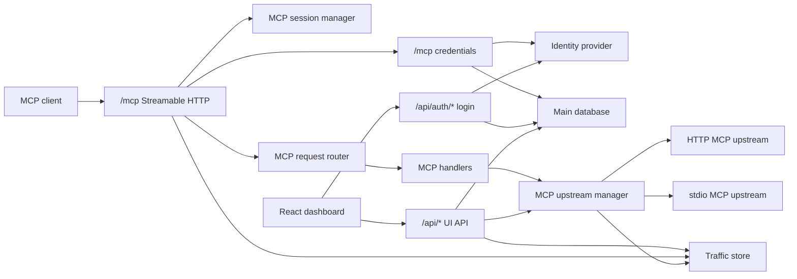
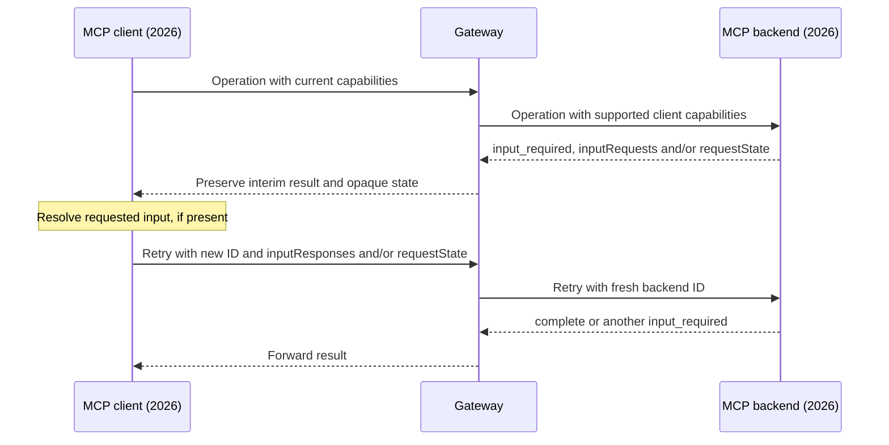

# aawa-mcpx design

This document describes the current architecture and protocol design, and the
planned design under consideration. [README.md](/README.md) gives the project
overview, setup, and operations; [CHANGELOG.md](/CHANGELOG.md) records changes.

## Contents

- [1. Main concepts](#1-main-concepts)
- [2. Runtime architecture](#2-runtime-architecture)
- [3. MCP protocol model](#3-mcp-protocol-model)
- [4. Tool calls](#4-tool-calls)
- [5. Persistence](#5-persistence)
- [6. Validation policy](#6-validation-policy)
- [7. Planned design](#7-planned-design)
- [8. References](#8-references)

## 1. Main concepts

| Term | Meaning |
| --- | --- |
| Gateway | Bun server and public HTTP surface. |
| JSON-RPC message | Request, notification, or response; distinct from an HTTP request/response. |
| MCP client | External client using `/mcp`. |
| MCP upstream | Configured backend MCP server. |
| UI | React dashboard pages under `/ui` (`/` redirects there), served by the gateway. |
| UI API | Dashboard HTTP API under `/api/*`, separate from MCP routes. Paths the MCP spec does not define go under `/api`. |

## 2. Runtime architecture

Figure ARCH-01: Request paths from MCP clients and the dashboard to upstreams, the identity provider and storage.

### 2.1 Source responsibilities

Paths are relative to `src/`. Server code never imports UI implementations;
the UI uses only UI-local modules and browser-safe `shared/` contracts. The MCP
SDK supplies types only; the gateway implements dispatch and transports itself.

| Layer | Modules and responsibilities |
| --- | --- |
| `server/` | `index.ts`: entrypoint (load configuration, start upstreams and the server, handle shutdown); `logger.ts`: console logging and `key=value` log fields. |
| `server/auth/` | `ui_auth.ts`: dashboard login (superadmin password, OIDC), sessions and the `/api/*` guard; `mcp_auth.ts`: `/mcp` credentials and protected resource metadata; `identity.ts`: IdP discovery, roles and profile claims, sign-in log lines; `access_routes.ts`: Auth tab API. |
| `server/db/` | `main.ts`: the gateway's own SQLite database and schema versions; `access.ts`: users, roles, permissions and API keys; `ui_sessions.ts`: dashboard session storage; `traffic.ts`: SQLite traffic storage. |
| `server/config/` | `schema.ts`: every user setting as ArkType schemas (environment variables and `mcp.json`); `loader.ts`: loads and persists `mcp.json`; `constants.ts`: file locations. |
| `server/gateway/` | `server.ts`: `Bun.serve`/route wiring; `allowed_hosts.ts`: `Host`/`Origin` allowlist and route guard; `unknown_routes.ts`: 404/405 for unhandled requests; `mcp_http_route.ts`: HTTP handling; `mcp_request_router.ts`: JSON-RPC dispatch/version adaptation. |
| | `json_rpc.ts`: incoming envelope parsing; `mcp_session.ts`: public initialization/sessions; `client_activity.ts`: dashboard history; `mcp_handlers.ts`: upstream operations and permission checks; `mcp_namespaces.ts`: applies namespaces, public-name titles and `[serverName]` description prefixes to catalogs; `ui_routes.ts`: UI APIs/events; `tester_routes.ts`: the dashboard Tester; `http.ts`: JSON error answers and query and body parsing. |
| `server/mcp_upstreams/` | `manager.ts`: stable gateway API/service wiring; `connections.ts`: per-backend state record, connection/recovery lifecycle; `health_checks.ts`: probes; `catalog.ts`: caches/exposure state. |
| | `method_calls.ts`: calls/argument validation; `protocol_client.ts`: JSON-RPC, revision selection, HTTP/SSE and stdio; `tool_result.ts`: structured recovery/duplicate removal; `input_schema.ts`/`output_schema.ts`: provider schema policies; `json_schema.ts`: shared compiler; `logged_request.ts`: traffic logging around calls; `types.d.ts`: manager contracts. |
| `shared/` | `mcp_protocol.ts`: revision registry, header encoding, `x-mcp-header` rules; `mcp_metadata.ts`: request-metadata validators; `mcp_namespaces.ts`: namespace and resource-URI codec; `mcp_schemas.ts`: MCP validators; `mcp_results.ts`: result types; `mcp_output_schema.ts`: object wrappers for 2025 clients. |
| | `ui_api.ts`: dashboard contracts, which also type the server's backend status and traffic records; `client_info.ts`: client identity; `cancellation.ts`: abort helpers; `common.ts`: cross-runtime helpers. |
| `ui/` | `index.html`: dashboard page; `main.tsx`: entrypoint it loads; `App.tsx`: state/routing; `base_components/`: low-level components and shared class names with `cn` (`classes.ts`); `components/`: app components, including sortable tables (`table.tsx`, `sort.ts`); `sections/`: pages, with the Auth tab's cards in `sections/auth/`; `api/`: dashboard API client; `index.css`: Tailwind entry; `i18n/` and `styles/`: assets. |

The compact footer links `© [current year] Aawa Technologies / Mikael Nakajima`
to [Aawa Technologies](https://aawa.jp). Test fixtures live next to the tests:
`server/mcp_upstreams/protocol_fixture.ts` runs a fake backend over HTTP or stdio,
`server/gateway/route_fixture.ts` wires the public route,
`server/auth/idp_fixture.ts` signs JWTs for the tests' local OpenID providers, and
`shared/mcp_schema_fixtures.ts` holds sample MCP values. `server/test_preload.ts`
silences the logger during tests.

### 2.2 Backend connections and recovery

Whether a backend has connected since the gateway started, enabled or
refreshed it decides which connection failures retry. The MCP specification defines no
retry policy; this is the gateway's own:

| Failure | Before the first connection | After it |
| --- | --- | --- |
| HTTP `401`/`403`, TLS certificate error | Stop | Stop |
| Transport failure, timeout, HTTP `408`/`429`/`5xx` | Retry for 5 minutes, then stop | Retry without limit |
| Anything else, such as a negotiation failure or a stdio command that cannot start | Stop | Retry without limit |
| `enabledTools` names a tool the backend does not list | — | Stop until **Refresh** or a tool toggle |

The startup window lets backends that start after the gateway connect. A
stopped backend shows the error with "Action required"; its **Refresh**, or
disabling and re-enabling it, starts it again. Transport failures retire the client and schedule recovery,
including lost initialized HTTP sessions. Failed tool calls are never replayed,
because their side effects may have completed.
At startup and on its **Refresh**, the gateway connects to a disabled backend
once, fetches its server details and catalogs for the dashboard, and
disconnects; the backend stays disabled. It does not
retry, health-check, or expose such a backend.

Retry delays are jittered: **5–10**, **10–20**, **20–40**, then **30–60 seconds**,
measured after each attempt finishes, following
[AWS retry guidance](https://docs.aws.amazon.com/sdkref/latest/guide/feature-retry-behavior.html).
Reconnects share one attempt per backend and connection epoch. A successful
reconnect, a backend toggle or a **Refresh** that restarts the backend resets
the backoff; disable and shutdown invalidate epochs and
cancel clients and timers.

Health probes run independently for enabled, connected backends after catalog
refresh; disable/reconnect invalidates stale results. Successful requests
suppress probes for **60 seconds**. Idle probes run on the next 10-second tick,
time out after at most 9 seconds (or the configured timeout if shorter), and mark
a backend down after two consecutive failures. An application request that loses
its connection or HTTP session marks the backend down at once, closes its client
(aborting its other in-flight requests), and schedules recovery. A request
timeout or HTTP error fails only that request; probes catch a backend that stops
answering. Probes do not refresh catalogs. Probes target configured backends, not general
internet connectivity; `2026-07-28` backends are probed with discovery.

### 2.3 Authentication

`ENABLE_SUPERADMIN` and `ENABLE_OIDC` turn on the login methods. With neither,
the dashboard and its API need no login, `/api/auth/*` and `/api/access/*`
answer `404`, the dashboard shows no user name or Log out, and `/mcp` needs no
credentials, so every enabled tool is usable. With either, the dashboard and
every `/api/*` route except `/api/health` (container health checks, answered
with only `{ "status": "ok" }`) need a dashboard session,
and every `/mcp` request needs credentials. `PUBLIC_URL` and `OIDC_ISSUER` must
be `https` except on `localhost`, `127.0.0.1` or `[::1]`; the gateway itself
may serve plain HTTP behind a TLS proxy. With OIDC, `server/auth/identity.ts`
discovers the IdP at startup through `openid-client`, so the gateway does not
start without it.

| Term | Meaning |
| --- | --- |
| Identity provider (IdP) | OAuth 2.1 authorization server and OpenID provider at `OIDC_ISSUER` |
| User | Who an MCP client or the dashboard signs in as, stored in the main database; realm and type are set when it is added and never change |
| Realm | OIDC: the user ID is the IdP's `sub`. Local: the gateway generates the ID |
| Type | Human: signs in itself. Machine: signs in with API keys; an OIDC machine is an IdP service account |
| Superadmin | The one Local human, named by `SUPERADMIN_USERNAME`; logs in to the dashboard with a password |
| Admin | Who may use the dashboard: the superadmin, and OIDC users with a role in `ADMIN_ROLES` |
| Role | A set of users that permissions are given to; matched to IdP roles by name |
| Backend enabled, tool enabled | The server-wide toggles (`enabled`, `enabledTools` in `mcp.json`); not permissions |
| Backend permission | Per user or role: the backend's prompts, resources and resource templates |
| Tool permission | Per user or role: one tool |
| Usable | Tool: backend enabled, tool enabled, tool permission. Prompts and resources: backend enabled, backend permission |

**Dashboard login** (`server/auth/ui_auth.ts`):

| Path | Method | Behavior |
| --- | --- | --- |
| `/api/auth/methods` | GET | The login methods that are on, for the login page `/ui/login`. |
| `/api/auth/password` | POST | With the superadmin: checks the password with `Bun.password.verify` and the username as SHA-256 digests in constant time; a mismatch gets `401`. Each connecting address (behind a proxy, all clients share one) has 5 failed attempts per 15-minute window, counted before the check so parallel attempts share them; beyond them `429`. A login clears the count. |
| `/api/auth/login` | GET | With OIDC: on another host than `PUBLIC_URL`, redirects there first. Keeps the pending login in memory (10 minutes, at most 100, oldest dropped; cookie `mcpx_login` on the callback path) and redirects to the IdP with `OIDC_SCOPES`, PKCE, state and nonce. `returnTo` names the page to return to; anything but a dashboard page means `/ui`. |
| `/api/auth/callback` | GET | With OIDC: redeems the code as a confidential client (`client_secret_basic`) and validates the ID token. An admin gets a session and returns to the page; a user without a role in `ADMIN_ROLES`, a disabled user and a Local user's ID get `403`. An unknown, expired or replayed login and an IdP error answer get `400`, a failed token request `502`. |
| `/api/auth/logout` | POST | Deletes the session and returns `{ logoutUrl }`: for an OIDC session the IdP's end-session URL with `post_logout_redirect_uri` `<PUBLIC_URL>/ui`, otherwise that page. |
| `/api/auth/session` | GET | `{ name }` of the logged-in user. |

A session is a random 32-byte ID in the cookie `mcpx_session` (`HttpOnly`,
`Secure`, `SameSite=Lax`, path `/`); the main database ([5](#5-persistence))
keeps its SHA-256 hash with the issuer (`local` for the superadmin), client ID
and every ID token claim (only `sub` for the superadmin). An OIDC session also
keeps the login's tokens for the Tester, encrypted with AES-GCM under a key
derived (HKDF) from the session ID, so the database alone cannot read them.
A session is valid until `UI_SESSION_MAX_AGE` after the login or
`UI_SESSION_IDLE_TIMEOUT` after its last use, which is written at most once a
minute, while its login method is on and, for OIDC, while it comes from this
issuer and client ID, holds a role in `ADMIN_ROLES` and its user exists and is
enabled. Disabling or deleting a user deletes its sessions at once, so a user
added again with the same ID never inherits them. Each request checks
validity and deletes an invalid session; an open event stream checks it on
each update, without counting as use, and ends once it fails.
Startup and each login delete all invalid sessions. Role changes at the IdP apply at the next login.
Non-GET `/api/*` requests need `Origin` equal to `PUBLIC_URL` (`403`, checked
first); without a valid session `/api/*` answers `401`. Bun serves the pages
as static bundles, so they load without a session; the first API call gets
`401` and the dashboard goes to the login. When the event stream closes, the
dashboard checks the session before reconnecting.

**`/mcp` credentials** (`server/auth/mcp_auth.ts`). Every request on every
protocol version carries `Authorization: Bearer <credential>`, checked before
anything else:

| Credential | Recognized by | Check |
| --- | --- | --- |
| Local API key | Prefix `sk_aawa_local01_` | SHA-256 of the key is a Local machine's key |
| OIDC API key | Prefix `sk_aawa_api01_`, then base64url of the service account's `<client ID>:<client secret>` | SHA-256 of the key is an OIDC machine's key; a client credentials grant with `OIDC_SCOPES`, then UserInfo, whose `sub` must be the key's user. Roles come from UserInfo and, for a JWT, the token's claims. The result is cached by key hash until the token expires (300 seconds without `expires_in`); parallel requests share one exchange, and a failed one is not cached |
| OAuth access token | Anything else, with OIDC | JWT signature against the issuer's JWKS (cached, refetched for an unknown key ID), `iss`, a required `exp`, `aud` containing `OIDC_AUDIENCE`, a required `sub` that is not a Local user's |

Missing or invalid credentials get `401` with `WWW-Authenticate: Bearer`,
with OIDC also `resource_metadata=…`; with OIDC,
`/.well-known/oauth-protected-resource/mcp` (and
`/.well-known/oauth-protected-resource`) serves RFC 9728 metadata naming the
issuer and `OIDC_SCOPES`. An IdP refusal of an OIDC key gets `401`, any other
failed IdP request `502`. An unknown or disabled user gets `403`. Only JWT
access tokens work, so MCP clients use an IdP app registered in advance unless
the IdP issues JWTs to dynamically registered clients. 2025 sessions
(`2025-06-18`, `2025-11-25`) belong to the user who initialized them; another
user's credentials get `404` for them. Backends never see client credentials.
Traffic records name the user ID with the MCP client.

Credentials the IdP vouches for sign their user in: an unknown user is added
as an enabled OIDC human without permissions, empty Name and Username are
filled from the token (from UserInfo when an access token lacks them), and the
user's roles follow the token. A sign-in is written and logged at most once a
minute per user, and at once when the token's roles change; disabled and Local
users stay unchanged. Key and user last-use times are written at most once a
minute.

**Users, roles and API keys** (`server/db/access.ts`). Admins manage them in
the Auth tab through `/api/access/*` (`server/auth/access_routes.ts`); every
change answers with the whole state. A new Local user is a machine with a
generated ID and a Name; a new OIDC user's ID is its IdP user ID. The
superadmin's user is added at first start and renamed with
`SUPERADMIN_USERNAME`; it cannot be deleted, disabled or renamed in the
dashboard. A token's roles are assigned to its user (unknown ones are added,
without permissions), roles the user's previous token named and this one drops
are unassigned, even if also assigned in the Roles card, and roles assigned
only in the Roles card stay; tokens never remove
users or roles. Renaming a role renames it in its users' last token roles too,
so a later token that drops it unassigns it, and one that names the old name
gets a new role. A Local key is the prefix and 32 random bytes (base64url),
made by the gateway. An OIDC key is built in the browser, which registers only
its SHA-256 and last 4 characters. Either key is shown once; the database keeps
only that hash and those characters. Revoking deletes the key.

**Permissions.** A user's permissions are its own plus those of its roles;
nothing is allowed until given, and admins, the superadmin included, get none
automatically. Backend and tool permissions are independent. Toggles and
permissions never change each other; permissions are stored by backend and
tool name and survive a disabled or unreachable backend or tool. Lists contain
only usable items. Calls are checked in order:

| Case | Answer |
| --- | --- |
| Tool unknown, hidden ([4.2](#42-input-schemas-and-arguments)), or tool or backend disabled, with or without permission | The unknown-tool error (`-32602`, [4.5](#45-tool-call-errors)) |
| Tool and backend enabled, no tool permission | HTTP `403` with `-32600`, without `insufficient_scope` |
| Usable | Forwarded |

`prompts/get` and `resources/read` follow the same order with the backend
permission and their usual errors ([3.8](#38-namespaces-and-resource-routing)).
There are no permissions for single prompts or resources.

**Tester** (`server/gateway/tester_routes.ts`). `/api/tester/mcp` takes the
`2026-07-28` request the browser built, signs it as the logged-in admin and
passes it to the `/mcp` handler like any MCP client request, permissions
included. An OIDC admin's access token, refreshed with the login's refresh
token once expired (parallel requests share one refresh, whose new tokens are
saved before any of them goes on), passes only when its `aud` names `OIDC_AUDIENCE`. The
answer holds both sides in full, secrets included.

**Logs.** Auth lines use snake_case `key=value` fields and never hold secrets,
keys or tokens:

| Prefix | Line |
| --- | --- |
| `Auth:` | One per sign-in: flow, user ID, IdP app or service account client ID, key ID, client address, roles, roles claim, granted scopes, and claim names |
| `Auth refused:` | A refused sign-in: flow, what is known of it, and why (warning) |
| `Auth sync:`, `Auth sync failed:` | A user or role added or roles unassigned by a token; a failed UserInfo request or login token refresh |
| `Auth admin:`, `Auth admin failed:` | An Auth tab change or refusal, with the admin's user ID |
| `Auth startup:` | The superadmin added, invalid sessions removed |

| ID | Decision | Reason |
| --- | --- | --- |
| SEC-DEC-01 | Two login methods, each switched on by its own setting: the superadmin's password (Local realm) and OIDC. With both off, nothing is protected. | The dashboard works without an IdP; setups that protect the gateway themselves can turn both off. |
| SEC-DEC-02 | Users, roles, permissions and API keys live in the main database; the IdP vouches for OIDC users and names their roles in tokens. | Users and roles arrive with tokens; the gateway needs no IdP admin API. |
| SEC-DEC-03 | OIDC users are keyed by the IdP's `sub`; Name and Username are labels that tokens fill while empty but never overwrite. | The `sub` never changes, so everything links to it. |
| SEC-DEC-04 | Every user has a realm and a type, fixed when it is added; Local users other than the superadmin are machines, and they sign in only with their own API keys. | An IdP token cannot sign in as a Local user. |
| SEC-DEC-05 | Tokens assign the roles they name and unassign those their user's previous token named, even when also assigned in the dashboard; roles assigned only in the dashboard stay; unknown roles are added. | Roles follow the IdP without a sync, and admins can still add roles. |
| SEC-DEC-06 | Only JWT access tokens on `/mcp`. | Opaque tokens would need introspection per request. |
| SEC-DEC-07 | API keys only for machines. | Humans sign in themselves. |
| SEC-DEC-08 | An OIDC machine's key is its service account's client ID and secret, built in the browser and registered by hash; `/mcp` exchanges it with the client credentials grant and caches the result. | The secret never passes the dashboard API, and the IdP stays the authority for the machine and its roles. |
| SEC-DEC-09 | Keys are stored as plain SHA-256; only stored keys sign in. | Keys are long random secrets; revoking takes effect at once. |
| SEC-DEC-10 | Missing permission is HTTP `403`; unusable items keep their usual errors. | The MCP authorization spec answers missing permissions with `403`. |
| SEC-DEC-11 | Disabled users are refused on `/mcp` (`403`) and in the dashboard; disabling or deleting an admin ends its dashboard sessions, open event streams included, at once. | Disabling takes effect without waiting for tokens or sessions to expire. |
| SEC-DEC-12 | The Tester signs as the logged-in admin: the superadmin's request is marked in process, an OIDC admin's carries the login's access token. | The superadmin has no token, and only gateway code can mark a request; the Tester meets the same checks as any MCP client. |
| SEC-DEC-13 | Auth tab refusals are typed: `400` unusable input, `404` unknown user, role or API key, `409` conflict with a rule or existing data. | The store's refusals keep their meaning in the answer. |
| SEC-DEC-14 | Sign-in lines log claim names, not values. | Names show where roles are missing. |

## 3. MCP protocol model

### 3.1 Revisions and negotiation

Clients and backends both support `2026-07-28`, `2025-11-25`, and `2025-06-18`;
`2025-03-26` is not supported. `shared/mcp_protocol.ts` is the ordered revision
registry; `CURRENT_PROTOCOL_VERSION` is its newest entry, the version the gateway
prefers and sends. Revision-specific behavior branches on `requiresInitialization`
or `usesRequestMetadata`, never on that entry. Client and backend
revisions are independent. `2026-07-28` uses per-request version and capability
metadata; the 2025 revisions initialize sessions. Unsupported initialization
proposals select `2025-11-25`, the highest supported revision requiring initialization.

Each backend selects the highest mutually supported revision on its first
successful connection and keeps it across connection epochs and toggles until
gateway restart. 2025 backends initialize afresh on reconnect and verify the
retained revision. Stdio carries newline-delimited JSON-RPC.

Discovery falls back to initialization only on a first connection (not for a
retained revision) and never on `-32020`–`-32022`:

| Backend | Discovery rejection that falls back |
| --- | --- |
| HTTP | HTTP `400`/`404`/`405`, except `404` with `-32601`; or HTTP `200`/no status with `-32600`/`-32601` |
| stdio | Any JSON-RPC error |

For compatibility with 2025 HTTP backends, the HTTP-status cases apply even if
the RPC envelope is invalid (for example, `id: null`). Only the HTTP status is
used; initialization, pinned peers, and application responses still require
valid envelopes and matching request IDs. Dropping that status during envelope
validation would stop negotiation before a compatible 2025 backend can initialize.
Other discovery failures count as negotiation failures, except transient
failures and HTTP `401`/`403`, which the dashboard shows as an authentication
error.
A discovery result without `2026-07-28` initializes with the highest 2025
revision it lists; one listing no supported revision is a negotiation failure.

For a negotiation failure, the dashboard shows the failed method, attempted
revision, and available HTTP/JSON-RPC codes; whether it retries follows
[2.2](#22-backend-connections-and-recovery). Restart to change a retained
revision.

### 3.2 Transports and catalogs

Public `POST /mcp` returns JSON-RPC over JSON. Required 2025 notifications and
responses receive HTTP 202 without a body. The 2026 path uses discovery,
per-request metadata, mirrored-header validation, and complete-result/cache
fields; removed methods return HTTP 404 with JSON-RPC method-not-found. A supplied
`MCP-Protocol-Version` must match the metadata (2026) or the session (2025).
A request takes the 2026 path when it is `server/discover`, carries protocol
version metadata, or has the exact `2026-07-28` header. Any other unsupported
header gets HTTP 400 / `-32600`.
Requests other than for `/`, the dashboard pages and their assets must name a host
listed in `ALLOWED_HOSTS` in `Host` and, when present, in `Origin`. Other
requests get HTTP 403, for `/mcp` POST and DELETE with a JSON-RPC error without
`id`, otherwise with `{ error }`. Checking both stops DNS rebinding, because a
rebinding page names its own host in both. Request bodies over 8 MiB get HTTP
413. Clients must accept both `application/json` and `text/event-stream`.
Until backend initialization finishes, 2025 messages and 2026 list requests
wait; if it fails they get HTTP 503 / `-32603`.

Public GET event streams and stdio are not exposed. The gateway sends no
server-initiated MCP messages and normally completes operations with one JSON
response. Backend HTTP must offer Streamable HTTP with JSON or SSE `POST`
responses; the backend's standalone `GET` event stream is not used. Backend stdio
is supported. Backend HTTP JSON bodies, stdio lines and SSE events are limited to
8 MiB, counted in bytes, and backend pagination to 1,000 pages and 32 MiB of
items as JSON in all.

A stdio backend's stdout lines that are not JSON-RPC messages are logged and
skipped. A stdout line over the limit, or stdout closing, is a transport failure
and starts recovery. Stderr lines are logged at info level, prefixed with the
backend name; a longer line is logged in pieces of about the limit. Closing a stdio backend closes
its stdin, sends `SIGTERM` if it has not exited after 1 s, and `SIGKILL` after
another 1 s.

Only a message with a `result` or `error` completes a gateway request; JSON-RPC
IDs belong to their sender. The gateway answers a 2025 backend's `ping` with `{}`
and every other backend request with `-32601`: over stdio on stdin, over HTTP as
a `POST` in the backend's session. `2026-07-28` defines no backend requests, so
stdio gets `-32601` and HTTP gets no answer. Backend notifications are ignored.
Backend SSE lines may end in CRLF, LF, or CR.

The gateway requests only the lists (tools, prompts, resources, resource
templates) that a backend advertises in its capabilities. Each 2026 backend list
is cached on its own: it expires at its fetch start time plus its TTL (the
smallest across pages), scoped to configured credentials, and a list without a
TTL is stale at once. Before a public list request (`tools/list`,
`prompts/list`, `resources/list`, `resources/templates/list`), the gateway
re-fetches that list from every connected 2026 backend where it is stale; before
`tools/call` it re-fetches only the target backend's tools. Concurrent requests
on one connection share one fetch per list; a new connection starts its own.
A failed re-fetch keeps serving the stale list.
2025 backend catalogs refresh only on connect, reconnect, enable, and dashboard
refresh. Dashboard refresh also repeats `server/discover` on a 2026 backend, so
its server info, capabilities, and instructions update; a 2025 backend keeps
what `initialize` returned for its session. All pages are materialized before [namespacing](#38-namespaces-and-resource-routing);
upstream cursors are not aggregate cursors. Public `2026-07-28` catalogs carry
private, zero-TTL cache hints.

Fixtures cover each supported backend revision over HTTP/stdio and all client
revisions; public HTTP tests cover `2026-07-28` request metadata and both 2025 session paths.

### 3.3 Sessions

| Concern | 2025-06-18 / 2025-11-25 | 2026-07-28 |
| --- | --- | --- |
| Context | Initialization retains revision/client information. | Per-request version/client metadata; no initialization session. |
| Public HTTP | Issue/require `Mcp-Session-Id`; session map resolves revision/identity. | No session ID issued or used. |
| Backend HTTP | Retain/send an ID only if issued; backends without IDs work. Closing sends `DELETE` with the ID; HTTP 405 is accepted. | Remove outgoing session headers; ignore returned IDs. |
| Backend stdio | Connection retains initialized context; no HTTP headers. | Per-request context; no HTTP headers. |
| DELETE | Remove session (HTTP 202); missing ID: HTTP 400; unknown/removed ID: HTTP 404. | HTTP 405 with `Allow: POST`. |

Public 2025 session IDs are a gateway choice: the specs permit servers to omit
them, but the gateway needs them to look up revision and identity. Unknown IDs
return HTTP 404 and require reinitialization. Public and backend IDs are separate
and never forwarded between connections. Backend IDs are reacquired on reconnect;
the selected revision persists.

Sessions exist only in memory, without lifecycle status, timestamps, idle expiry,
or cleanup timers. `MCP_MAX_SESSIONS_PER_CLIENT` (positive integer, default `10`)
limits retained sessions per user and reported name/version pair across both
2025 revisions, and `MCP_MAX_SESSIONS_PER_USER` (default `100`) a user's
sessions of all clients; an invalid value stops startup. Successful
initialization beyond a limit evicts that user's oldest session of the pair,
otherwise its oldest of all, by insertion order, so one user never evicts
another's. Request activity does not reorder sessions, and invalid
initialization evicts none. DELETE removes
a session immediately; gateway restart clears all sessions.

### 3.4 Client identity

Reported name/version identifies an MCP client to the dashboard, not to
authentication; the user comes from its credentials ([2.3](#23-authentication)).
The whole reported client info is kept in both revisions; the UI shows name,
version and title. Name, version and title are at most 256 characters and the
whole client info at most 64 KiB as JSON; longer ones are refused (`-32602`). The activity history keeps one entry per reported
name/version, user and protocol, at most 200, the least recently seen dropped; a refused
request's entry has no user. It survives session closure/eviction and resets
on restart.

Gateway-generated logs, traffic-record identity, and dashboard contracts exclude
session IDs; logs use reported name/version where available. The logger writes
control characters as JSON escapes, so a reported name cannot add log lines. The UI shows the
user, first/last activity and protocol, without connection status.

### 3.5 `2026-07-28` HTTP metadata and headers

For `2026-07-28`, each request supplies its own version and client capabilities;
optional client identity, log level, and progress token are validated with them.
Malformed metadata returns HTTP 400 / `-32602`; another protocol version returns
HTTP 400 / `-32022` with the supported list; missing or mismatched mirrors return
HTTP 400 / `-32020`. Notifications and responses on this path return HTTP 400 / `-32600`. Client capabilities validate once per request, do not
carry between requests, and stay separate from backend capabilities: the gateway
advertises only features it implements.

The catalog compiles each tool's `x-mcp-header` rules once when it fetches the
tool, failures included. A call resolves its tool once and uses those rules for
both the public header check and the backend hop. Stale catalogs refresh before
public header checks. A tool with invalid
annotations is hidden from 2026 HTTP clients, with a warning, but stays in the
catalog and in `enabledTools`. When the backend itself is a 2026 HTTP backend,
calls to that tool fail before reaching it, because its headers cannot be built.
2025 and stdio connections do not apply that annotation contract.
Mirrors use strict UTF-8 Base64 decoding where required and compare integers
numerically (`42.0` matches `42`). Recognized headers for absent/null arguments
are rejected.

Each backend HTTP hop rebuilds protocol, method, name, and recognized parameter
headers from its own revision, original backend name/URI, and arguments. Unknown
parameter mirrors pass through `2026-07-28` hops; 2025 hops omit mirrors. Static
backend configuration cannot override these request fields. See the
[HTTP binding](https://modelcontextprotocol.io/specification/2026-07-28/basic/transports/streamable-http)
and [request metadata](https://modelcontextprotocol.io/specification/2026-07-28/basic).

### 3.6 Request metadata forwarding

`tools/call`, `prompts/get`, and `resources/read` preserve application/vendor
`_meta`, including trace context, across all supported revisions and backend
transports. Metadata validates once at the public boundary; `ProtocolClient.rpc`
copies application fields and rebuilds backend context without revalidating or
mutating the client request. `2026-07-28` backend requests use the gateway's own
version, identity, and capabilities; 2025 requests omit that envelope.

Progress/log notification opt-ins and task/subscription handles are not
forwarded, because the gateway cannot relay those flows. A valid progress token is
accepted without promising updates, as permitted by the
[progress contract](https://modelcontextprotocol.io/specification/2026-07-28/basic/utilities/progress).
Continuations return `-32602`. Task options are rejected for June 2025 and 2026;
November 2025 ignores them and executes normally, following the
[no-task-capability rule](https://modelcontextprotocol.io/specification/2025-11-25/basic/utilities/tasks#task-support-and-handling).

### 3.7 Cancellation

Both 2025 revisions cancel through session-scoped `notifications/cancelled`;
disconnect alone does not cancel. The 2026 HTTP path cancels on disconnect.
Cancelled requests end without a JSON-RPC result/error (an empty SSE response
when the connection remains open). Unknown, completed, or malformed cancellation
notifications are ignored; `initialize` cannot be cancelled.

The HTTP route owns active 2025 request controllers keyed by session and typed ID;
2026 requests use their own disconnect signals. Signals pass through dispatch and
rate limiting to `ProtocolClient`, which cancels with the backend's own request
ID: notifications for 2025 HTTP and all stdio revisions, stream closure for
2026 HTTP. Cancellation stops queued dispatch, ignores late replies, and does not
trigger recovery. Completion/cancellation removes controllers and listeners, so
an abandoned response cannot complete another request. Shared catalog refreshes
continue for other callers. Delivery is best effort; cancellation cannot undo
side effects. See the cancellation contracts for
[June 2025](https://modelcontextprotocol.io/specification/2025-06-18/basic/utilities/cancellation),
[November 2025](https://modelcontextprotocol.io/specification/2025-11-25/basic/utilities/cancellation),
and [2026](https://modelcontextprotocol.io/specification/2026-07-28/basic/utilities/cancellation).

### 3.8 Namespaces and resource routing

| Item | Public form |
| --- | --- |
| Tools, prompts | `serverName__itemName` |
| Resources | `aawa-mcpx://resource/<namespace>/<encoded-original-uri>` |
| Resource templates | `aawa-mcpx://template/<namespace>/<original-template>` |

Tools and prompts get their public name as `title`, and tools with
`annotations` as `annotations.title` too; the backend's titles reach only the
dashboard. Clients show a title before the name, so a backend's own title
would hide which backend owns the item. Descriptions start with
`[serverName]`. Ordinary names stay readable. Ambiguous backend names (including `__`, a trailing
`_`, or exactly `.` or `..`), names outside `A-Za-z0-9_.-`, and the reserved
`mcpx-` prefix use `mcpx-` followed by four hex digits per UTF-16 code unit. The
dashboard uses the same codec for tool toggles. Resource wrappers use the same
backend namespace and percent-encode the entire original URI, preserving case,
percent escapes, queries, and fragments without URL normalization. Resource URI
schemes must follow RFC 3986, so the gateway uses a fixed scheme rather than
backend names as schemes. `backend://original-uri` references also route when
the backend name is a valid URI scheme other than `aawa-mcpx` and the original URI
is itself absolute. Because the resource wrapper encodes the whole original URI,
a read routes any absolute backend URI exactly as listed, including spaces and
non-ASCII characters. Template and `backend://` reads accept only valid ASCII
RFC 3986 URIs.

Clients expand resource templates themselves, so template wrappers keep the
backend template unencoded. A URI expanded from a wrapped template is the
backend's own expansion behind the template prefix, and a read strips the prefix
without decoding.

Only MCP resource fields are wrapped: catalogs, read contents, tool links/embedded
resources, and prompt embedded resources; text and structured output stay intact.
Backend responses in traffic records remain original. Reads
decode once and route without requiring catalog membership, because tool links
need not occur in `resources/list`. Malformed routes return `-32602`, and unknown or
disabled backends `-32002` for 2025 clients and `-32602` for 2026 clients;
disconnected backends return `-32603`. Backend errors keep the
client-version adaptation of [4.5](#45-tool-call-errors). The same codec applies
to all supported revisions.

### 3.9 Feature scope

Tools, prompts, resources, and resource templates work across supported revisions. Interactive
continuations, sampling, elicitation, subscriptions, and tasks are not advertised,
and unsupported interactive results fail explicitly ([7.2](#72-interactive-mcp-requests)
covers the planned design). Backend credentials define their authorization
context; MCP client credentials and permissions are the gateway's own
([2.3](#23-authentication)).

For 2025 clients the gateway answers `completion/complete` with empty values,
and `logging/setLevel` and `ping` with `{}`. For 2026 clients these methods and
`initialize` return HTTP 404 / `-32601`. Results for 2025 clients drop the 2026
`resultType`, `ttlMs`, and `cacheScope` fields. The gateway identifies itself,
to clients and backends, with the name and version from `package.json`.

## 4. Tool calls

### 4.1 Call path

The call path:

1. Validate arguments once against the cached input validator ([4.2](#42-input-schemas-and-arguments)).
2. Capture the cached output schema before dispatch; record the original backend response.
3. Validate the result envelope and content blocks ([4.3](#43-tool-results)).
4. Recover missing structured output when the tool has an output schema and JSON content is unambiguous.
5. Validate successful output, warning without changing data ([4.4](#44-output-schemas)).
6. Remove only JSON text equal to the entire structured value; preserve independent content and metadata.
7. Adapt MCP catalogs/results to the client revision.

### 4.2 Input schemas and arguments

Every supported revision requires `inputSchema.type: "object"`. Catalog fetches
validate and compile input schemas once; MCP calls reuse
those validators for one argument-validation pass before rate limiting or
dispatch. Input mismatches never reach backends.

Unusable schemas hide only the affected tool from MCP catalogs, with a warning.
One rule decides which tools MCP clients see and call, so a call to a hidden
tool returns `-32602` like an unknown one. Raw dashboard definitions and exposure settings remain,
so a refresh restores the tool after its schema is repaired.

Malformed call parameters return JSON-RPC `-32602` in every revision. Objects that
fail the tool's schema return `-32602` for
[2025-06-18](https://modelcontextprotocol.io/specification/2025-06-18/server/tools#error-handling),
or `isError: true` for
[2025-11-25](https://modelcontextprotocol.io/specification/2025-11-25/server/tools#error-handling)
and [2026-07-28](https://modelcontextprotocol.io/specification/2026-07-28/server/tools#error-handling).
The client revision controls this response independently of the backend revision.

### 4.3 Tool results

Backend tool results require a `content` array with valid text, image, audio,
resource-link, or embedded-resource blocks, including Base64 data and optional
metadata shapes. Malformed results are rejected before recovery or duplicate
removal; extension fields are preserved. Both 2025 revisions require object-shaped
backend `structuredContent`; `2026-07-28` permits any JSON value.

Results remove only text blocks whose entire JSON value equals
`structuredContent`, ignoring formatting and object key order. Independent text,
JSON subsets or extra fields, images, audio, and resources remain. The required
`content` array may become `[]`. Backend traffic retains the original result.

Omitting duplicate text deliberately departs from the spec's
[serialized-JSON `SHOULD` recommendation](https://modelcontextprotocol.io/specification/2025-06-18/server/tools#structured-content)
to avoid sending data twice. Structured output does not replace independent text
(see the [array-output example](https://modelcontextprotocol.io/specification/2026-07-28/server/tools#output-schema)).
Empty-array compatibility still needs confirmation in each consuming application.

### 4.4 Output schemas

Provider `outputSchema` definitions appear in catalogs and the dashboard. Ajv and
`ajv-formats` validate successful results and compile input schemas using JSON
Schema 2020-12 by default, or declared draft-07/2019-09.

For tools that advertise an output schema, missing `structuredContent` is
recovered from complete JSON text blocks up to 2 Mi UTF-16 code units each: use
a single distinct value even if it mismatches the schema (unless the schema's
root is an array); with multiple values, require a unique schema match or an array schema that validates
the ordered JSON items (including duplicates). Ambiguous/non-JSON content stays unchanged,
and so does every result of a tool without an output schema. Missing or recovered
structured output logs a warning; recovered results use the same duplicate-removal policy.

Mismatches, invalid schemas, unsupported dialects, and unresolved references log
warnings with backend/tool identifiers while returning results normally. This
deliberately tolerates violations of the spec's
[conforming-result `MUST` rule](https://modelcontextprotocol.io/specification/2026-07-28/server/tools#output-schema);
an advertised schema therefore does not guarantee conformity. Validation never
coerces data, inserts defaults, or removes properties, and skips `isError: true`.
Input and output schemas share limits of 256 Ki characters of serialized JSON,
10,000 visited values, and 64 nesting levels. Exceeding them blocks the affected input tool or warns for output.
External references are never fetched, following the
[MCP JSON Schema requirements](https://modelcontextprotocol.io/specification/2026-07-28/basic#json-schema-usage).

Validators and validation issues use weak schema-object keys. Each dialect has
one shared Ajv instance; provider `$id` values are never registered in it, so
duplicates stay isolated, and Ajv forgets each schema after compiling it.
Replacement catalogs compile fresh validators.

| Client revision | Structured output | Adaptation |
| --- | --- | --- |
| [2025-06-18](https://modelcontextprotocol.io/specification/2025-06-18/server/tools#structured-content), [2025-11-25](https://modelcontextprotocol.io/specification/2025-11-25/server/tools#structured-content) | JSON object | Wrap non-objects as `{ "value": ... }`; schemas permitting non-object output wrap both schema and result, including objects in unions |
| [2026-07-28](https://modelcontextprotocol.io/specification/2026-07-28/server/tools#structured-content) | Any JSON value | Preserve objects, arrays, strings, numbers, booleans, and `null` |

`false`, `0`, `""`, and `null` are present values. Object-only schemas and matching
objects stay unchanged across revisions; the dashboard retains provider shapes.
`shared/mcp_output_schema.ts` and the router wrap 2025 schemas and results
consistently; embedded schema resources preserve root-relative references and
anchors. A root `$ref` moves into `allOf`, because beside `$id` it makes Ajv
recurse forever and draft-07 ignores it. The SDK's object-only `CallToolResult` requires a wider gateway type,
with client restrictions applied at the response boundary.

### 4.5 Tool-call errors

Tool execution failures remain `isError: true` results with their feedback,
following the [tool error distinction](https://modelcontextprotocol.io/specification/2026-07-28/server/tools#error-handling).
Lookup, transport, malformed-response, and gateway failures use protocol errors:

| Failure | JSON-RPC code |
| --- | --- |
| Unknown/disabled tool or backend, invalid prefixed name | `-32602` |
| Resource of an unknown/disabled backend, for 2025 clients | `-32002` |
| Disconnected backend, transport failure, malformed backend result, gateway dispatch failure | `-32603` |

Backend RPC errors validate their envelope and request ID before forwarding and
keep message/data; codes adapt to the client revision, recovered from the retained
2025 session or 2026 request metadata. For 2026, resource-not-found `-32002`
becomes `-32602`, and retired or unassigned reserved codes become `-32603`, per
the [error-code policy](https://modelcontextprotocol.io/specification/2026-07-28/basic#error-codes).
`2026-07-28` request-metadata errors become `-32603` for 2025 clients; URL-elicitation `-32042`
is preserved only for [2025-11-25](https://modelcontextprotocol.io/specification/2025-11-25/client/elicitation#url-elicitation-required-error).

For `tools/call`, `prompts/get`, and `resources/read`, transport and
malformed-result failures become `-32603` RPC errors: HTTP 200 for 2025 clients,
HTTP 500 for 2026 clients. Prompt messages and resource contents are validated
like tool content blocks.

Ordinary 2025 RPC errors keep HTTP 200. Gateway-generated transport errors use
JSON-RPC `-32600` with these HTTP statuses: missing session 400, unknown session
404, header mismatch 400, `Host` or `Origin` not in `ALLOWED_HOSTS` 403, unacceptable `Accept` 400, and the credential and permission answers of [2.3](#23-authentication) (401, 403, 502). The 2026 binding uses HTTP 400 for
invalid requests/parameters and metadata errors, 404 for unknown methods, and
500 for internal errors. HTTP handler failures use 500 in every revision.
Backend HTTP statuses stay local to backend recovery/negotiation and are not
copied across protocol boundaries.

## 5. Persistence

| State | Storage and lifetime |
| --- | --- |
| Backend/tool exposure | `mcp.json`: read once. A tool catalog fetch or dashboard change that alters `enabled`, `enabledTools`, or `availableTools` writes the file as read with only those fields changed (no defaults added, in place, so a single-file Docker mount keeps working); unchanged state is not written. External edits are not reread or merged. Disable keeps tool settings, catalogs, and server details, and the dashboard still shows them. MCP clients get no catalog from a disabled backend or one with a configuration error. |
| Main database | `server/db/main.ts` opens `db/main.db` at startup, kept across restarts (WAL, foreign keys on). The schema version is `PRAGMA user_version`: migrations missing from the file run in order, each in its own transaction; a version newer than the code stops startup. Tables: `ui_sessions` (version 1, [2.3](#23-authentication)); `users`, `roles`, `user_roles`, `permissions`, `api_keys` and the sessions' encrypted login tokens (version 2). |
| Traffic | `server/db/traffic.ts` stores current-run request/response records in the `traffic` table of `db/traffic.db`, keeping the newest 10,000 records of at most 512 MiB stored text in all; a request or response over 256 KiB is stored as `{ truncated: true, bytes, start }` with its first 16,384 characters, and a client label, method or protocol version over 256 characters as its first 256 and `…` (backend names stay whole), while the message itself is unchanged. The table is cleared at startup and written with `synchronous=NORMAL`. JSON-RPC errors and tool results with `isError: true` count as errors. A failed write is printed to the console and never changes the reply. |
| Sessions/client activity | In-memory state with the retention limits in [3.3](#33-sessions) and [3.4](#34-client-identity); cleared on restart. Pending OIDC logins, failed password login counts and exchanged OIDC API keys ([2.3](#23-authentication)) are in memory too. |

## 6. Validation policy

ArkType is the default for JSON-RPC envelopes, `2026-07-28` request metadata/capabilities,
handled method parameters, HTTP API bodies and queries, environment variables and
`mcp.json`, upstream response shapes, and UI overview/debug contracts. Settings
and dashboard inputs refuse unknown fields and invalid values instead of falling
back to defaults. Ajv and `ajv-formats` are runtime dependencies used
only for arbitrary provider JSON Schema, which ArkType cannot import.

`ProtocolClient.rpc` validates backend envelopes and result shapes once; the
catalog and call layers use them as is. Health checks validate `ping` results,
which `rpc` does not check. JSON-RPC envelopes require string/integer IDs, integer error
codes, and matching response IDs; only the initial discovery fallback in
[3.1](#31-revisions-and-negotiation) tolerates an invalid envelope.

Custom parsing handles request/notification envelopes, headers (`Accept`, `Host`,
`Origin`, session/protocol IDs), URL pagination/filter coercion, schema-driven form inputs,
SQLite row mapping, and error normalization. `shared/` is the only intentional
cross-runtime layer.

## 7. Planned design

Nothing in this section is approved for implementation unless it says so.

### 7.1 List-changed notifications

**Status: TODO; one batch for every catalog and permission change.** The
gateway sends no `notifications/tools/list_changed`,
`notifications/prompts/list_changed` or `notifications/resources/list_changed`
([3.2](#32-transports-and-catalogs)), so MCP clients see a changed catalog
(toggles, refreshes, reconnects) or changed permissions
([2.3](#23-authentication)) only when they list again.

### 7.2 Interactive MCP requests

**Status: next; scope (native relay, translation) remains undecided.**
The runtime rejects continuation parameters and backend `input_required` results
and advertises no interactive client capabilities. Any future support must retain
ordinary calls across all three client/backend revisions and both backend transports.

| Term | Alternatives | Meaning | Notes |
| --- | --- | --- | --- |
| Input request | `inputRequests` | Embedded elicitation, sampling, or roots request. | Availability depends on client capabilities. |
| 2025 interaction | Reverse request | Standalone server-to-client JSON-RPC request in 2025. | Requires a response channel and correlation. |
| MRTR | Multi Round-Trip Requests | Interim result followed by a new request carrying input. | Introduced in 2026; replaces reverse requests. |
| Native relay | 2026 → 2026 | MRTR between peers using `2026-07-28`. | No translation. |
| Request state | `requestState` | Backend-owned opaque continuation string. | Never parse or modify its contents. |
| Translation | Interactive bridge | Convert MRTR to 2025 interactions, or the reverse. | Adds gateway-owned operation state. |

#### 7.2.1 Options and compatibility

| Option | Coverage | Cost and constraints |
| --- | --- | --- |
| Defer | Existing ordinary calls. | Interactive limitations remain explicit. |
| Native MRTR only | 2026 client → 2026 backend, HTTP or stdio. | Independent rounds; no gateway continuation store or 2025 response channel. |
| Native plus translation | Selected mixed-revision pairs; 2025 → 2025 relay could also be selected. | Pending calls, response channels, capability isolation, expiry, and cleanup; revision differences still limit coverage. |

Translation is optional. With native-only support, every pair involving a 2025
peer keeps noninteractive behavior: send no MRTR fields to 2025 backends,
forward no interactive capabilities on incompatible paths, and fail explicitly
if an interim result cannot be represented. Do not upgrade peer revisions,
fabricate input, replay an operation to conceal incompatibility, or claim completion.
Tasks, subscriptions, progress relaying, an integrated model provider, and a
client filesystem service are outside this proposal. External clients own their
interaction UI, sampling, and roots; the dashboard is a separate consumer.

#### 7.2.2 Native relay requirements

Figure MRTR-01: Native relay leaves interaction and continuation ownership at
the endpoints. The retry cycle can repeat.

- Validate `complete` and `input_required` separately. Only `tools/call`,
  `prompts/get`, and `resources/read` permit interim results. At least one of
  `inputRequests` or `requestState` must be present; state-only rounds are valid.
- Preserve keys, extension fields, direct-result response maps, and exact state,
  including empty strings or absence. Forward partial replies; the backend owns
  matching them to earlier inputs and requesting missing input again.
- Rebuild gateway identity, metadata, and HTTP mirrors on each round. Forward
  only current client capabilities intersected with implemented relay support,
  including elicitation modes and sampling options. There is no MRTR capability
  flag. Preserve missing-capability errors; capabilities are not authorization.
- Route each retry by its ordinary name/URI and current exposure checks, never
  by state. Native relay needs no state wrapper or pending-operation registry;
  the backend owns state integrity, expiry, and authorization checks.
- Use fresh backend IDs and never retry automatically, including state-only
  results. Timeout/cancellation applies to the active RPC; the gateway does not
  wait while the client obtains input. Interim results are successful protocol
  exchanges for health and are not cacheable.
- Apply output-schema checks, structured-output recovery, duplicate removal,
  and resource rewriting only to complete results. Preserve roots URIs and
  sampling tool names without gateway namespacing.

#### 7.2.3 Translation requirements

| Direction | Required lifecycle |
| --- | --- |
| 2026 client → 2025 backend | Hold the backend RPC pending, expose reverse requests as MRTR, and bind subsequent retries to that operation without executing it again. |
| 2025 client → 2026 backend | Hold the client operation pending, send reverse requests through its response channel, collect replies, and issue fresh backend MRTR rounds. |
| 2025 client → 2025 backend, if selected | Relay reverse requests with independent IDs and caller/session attribution; no MRTR conversion. |

2025-client support requires public SSE request delivery and client-response
dispatch; GET streams and reconnection/resumption need an explicit coverage
decision. 2025 backend HTTP/SSE and stdio also need reverse-request handling.
Payload conversion alone is insufficient. The design must resolve:

- Bounded pending-call storage, quotas, expiry, and tokens bound to backend,
  method, arguments, and trustworthy caller context. Reported name/version is
  not authentication. Duplicate/stale/conflicting retries must not duplicate
  side effects. Any wrapper preserves the inner backend state unchanged.
- Capability-compatible connection pooling or conservative restrictions:
  2025 capabilities are initialized per connection. Attribute reverse
  requests safely during concurrent calls and outside the three MRTR operations.
- Cleanup after cancellation, session deletion/eviction, stream loss, backend
  restart/disable, gateway restart, and late replies. Decide persistence and
  replay semantics; never silently replay abandoned operations.
- Revision-specific form/URL elicitation and completion flows, sampling tools/
  context, and roots. June lacks November's URL elicitation and sampling-tool
  additions; 2026 changes URL elicitation again. Reject unsupported conversions
  explicitly, and never fabricate successes for declines or sampling failures.
- Limits on rounds, outstanding inputs, payload size, and waiting time.

#### 7.2.4 Validation and implementation decisions

Use ArkType for protocol shapes and Ajv only for provider JSON Schema. Validate
new public requests and backend results once at their boundary; downstream
layers consume validated types. Native retries are new untrusted
requests, so one argument-validation pass per retry remains necessary.

Acceptance fixtures must cover HTTP/stdio, repeated rounds, multiple/partial
inputs, state-only and absent/empty state, form/URL elicitation, sampling, roots,
declines, malformed messages, missing capabilities, concurrent callers/backends,
cancellation, fresh IDs, and unsupported pairs. Preserve complete-result/schema
behavior and all supported revisions. Translation adds ownership, expiry, retry,
isolation, and cleanup cases. Run lint first; retain discovery/envelope regressions.
Enable each capability only after its entire selected path passes. Real consuming
client/backend combinations still need interoperability confirmation.

| ID | Decision needed | Current position / next evidence |
| --- | --- | --- |
| MRTR-DEC-01 | Whether and when to implement? | Decided: implement next. Native-only remains the simpler candidate for the first step. |
| MRTR-DEC-02 | Which pairs need translation? | Identify concrete clients/backends and interactions before selecting either direction. |
| MRTR-DEC-03 | Which 2025 transports/features? | Define coverage, connection isolation, and explicit unsupported cases. |
| MRTR-DEC-04 | Continuation ownership and retention? | Resolve caller binding, quotas, expiry, retry semantics, and restart policy. |
| MRTR-DEC-05 | Interactive dashboard support? | Separate scope; gateway relay needs no built-in model or filesystem service. |

Conditional commit boundaries: native support could use two commits—validated
contracts/backend handling, then complete public relay/capabilities/tests/docs.
Keep public rejection and interactive capabilities disabled between them.
Translation would likely add four or five substantial batches: 2025 response
channels/correlation, continuation ownership/lifecycle, each bridging direction,
and remaining revision-specific interoperability. Every enabled path includes
its own tests, limits, and cleanup. These are complexity estimates, not a schedule.

### 7.3 Continuous integration

**Status: TODO; needs its own design. Lowest priority.** No CI runs today:
`.github/` is excluded by `.gitignore`. The design must cover which checks run
(`bun lint`, `bun test`), image builds and publishing, release tagging, the
build-context checksum (which must include the Dockerfile and file paths), and
whether `bun audit` findings fail the image build (the Dockerfile only warns).

### 7.4 Configuration in the dashboard

**Status: TODO; needs its own design.** The user provides the initial
`mcp.json`; after that the gateway manages it. The dashboard should support
every change that editing the file allows: adding, removing, and modifying
backends, including transport settings, credentials, timeouts, and traffic
limits. Today it can only enable or disable backends and tools.

### 7.5 stdio backends in the dashboard

**Status: TODO; needs its own design.** A backend card shows the `mcp.json`
fields `type` and `url`. For a stdio backend it shows `type` and `command`
only; which of `args`, `env`, and `cwd` to show, and how, is undecided.

### 7.6 Linting gaps

**Status: TODO; waiting for Bun's built-in linter in a stable release.** The
`lint` script runs `bun check` and `biome check --fix`. Neither reports uses of code
marked `@deprecated` in JSDoc: `bun check` reports what `tsc` reports, and `tsc`
leaves deprecation to editor suggestions. Biome's `noDeprecatedImports` flags
imports of deprecated exports only, not calls such as `Database.exec` from
`bun:sqlite`; a general rule is an open request
([biomejs/biome#9580](https://github.com/biomejs/biome/discussions/9580)).
Bun's built-in linter ([`bun lint`](https://bun.com/docs/lint)) has
`@typescript-eslint/no-deprecated`, takes its types from `bun check`, and is
configured in `bunfig.toml`. Once it is in a stable release, decide whether it
replaces Biome's linter or runs alongside it, and turn on the rules Biome does
not cover, starting with `@typescript-eslint/no-deprecated`.

### 7.7 Runtime options

| Option | Revisit when |
| --- | --- |
| Positive aggregate catalog TTL | Derive freshness from the minimum remaining backend TTL and exposure-policy lifetime; preserve authorization isolation. Current public TTL remains zero. |
| `bun test --parallel` | Enough independent files benefit from workers. |
| `--smol` | Deployed memory becomes a constraint; benchmark first. |
| Isolated linker/global virtual store | Workspace growth or repeated worktree installs justify it. |
| React Compiler | Stable release or measured rendering bottleneck. |
| `process.on("memoryPressure")` | Substantial disposable in-memory caches. |
| HTTP/2 or HTTP/3 | Stable Bun support and an MCP/deployment requirement justify compatibility risk. |

### 7.8 Structured logs

**Status: TODO; needs its own design.** The logger writes text lines. Logs
should move to structured JSON, one object per line, with snake_case field
names. Sign-in and Auth tab lines already use snake_case `key=value` fields
(`logFields` in `server/logger.ts`) to make that move simple.

### 7.9 Issuer change

**Status: TODO.** OIDC users are keyed by `sub` and roles by name, without the
issuer. Pointing `OIDC_ISSUER` at another IdP while keeping `db/main.db` lets
that IdP's subjects and role names inherit the stored users, roles and
permissions. Store the issuer with the access data once and refuse to start
with a different one (exit code 78) until the database is reset.

## 8. References

- Resource URI/read contracts: [2025-06-18](https://modelcontextprotocol.io/specification/2025-06-18/server/resources), [2025-11-25](https://modelcontextprotocol.io/specification/2025-11-25/server/resources), [2026-07-28](https://modelcontextprotocol.io/specification/2026-07-28/server/resources). Tool resource links need not occur in catalogs: [2025-11-25](https://modelcontextprotocol.io/specification/2025-11-25/server/tools#resource-links), [2026-07-28](https://modelcontextprotocol.io/specification/2026-07-28/server/tools#resource-links).
- MCP 2026-07-28: [versioning](https://modelcontextprotocol.io/specification/2026-07-28/basic/versioning), [HTTP binding](https://modelcontextprotocol.io/specification/2026-07-28/basic/transports/streamable-http), [caching](https://modelcontextprotocol.io/specification/2026-07-28/server/utilities/caching).
- Optional session IDs: [2025-06-18](https://modelcontextprotocol.io/specification/2025-06-18/basic/transports#session-management), [2025-11-25](https://modelcontextprotocol.io/specification/2025-11-25/basic/transports#session-management).
- Interactive requests: [2026 MRTR](https://modelcontextprotocol.io/specification/2026-07-28/basic/patterns/mrtr) and [request metadata](https://modelcontextprotocol.io/specification/2026-07-28/basic); roots: [2026](https://modelcontextprotocol.io/specification/2026-07-28/client/roots).
- Elicitation: [June 2025](https://modelcontextprotocol.io/specification/2025-06-18/client/elicitation), [November 2025](https://modelcontextprotocol.io/specification/2025-11-25/client/elicitation), [2026](https://modelcontextprotocol.io/specification/2026-07-28/client/elicitation). Sampling: [June 2025](https://modelcontextprotocol.io/specification/2025-06-18/client/sampling), [November 2025](https://modelcontextprotocol.io/specification/2025-11-25/client/sampling), [2026](https://modelcontextprotocol.io/specification/2026-07-28/client/sampling).
