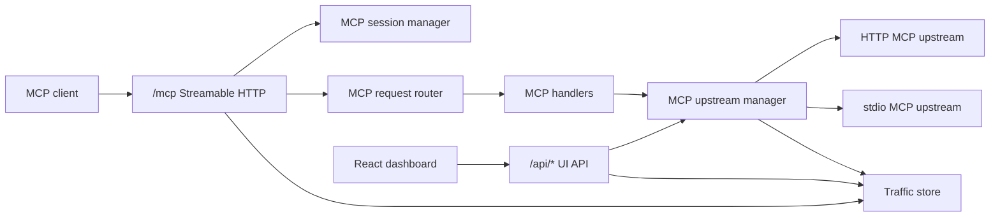
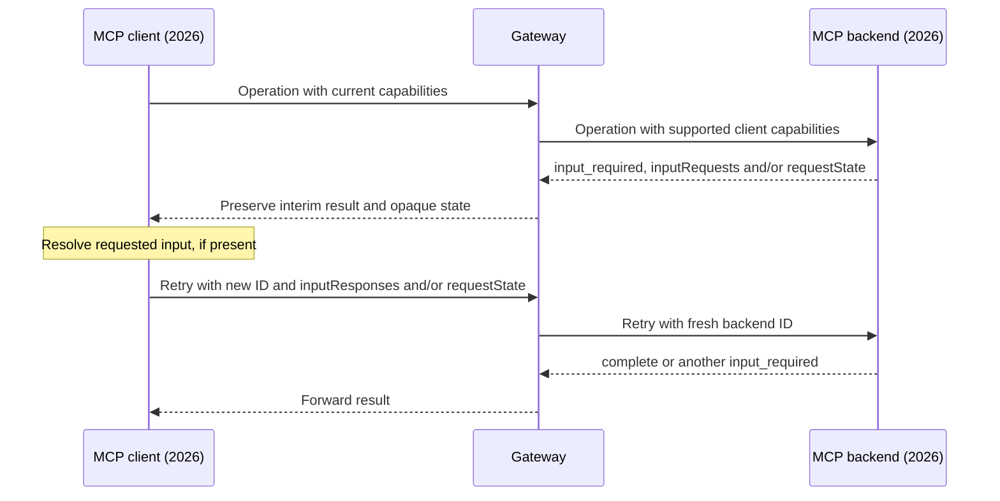

# aawa-mcpx design

This document describes the current architecture and protocol design, and the
planned design under consideration. [README.md](README.md) gives the project
overview, setup, and operations; [CHANGELOG.md](CHANGELOG.md) records changes.

## Contents

- [1. Main concepts](#1-main-concepts)
- [2. Runtime architecture](#2-runtime-architecture)
- [3. MCP protocol model](#3-mcp-protocol-model)
- [4. Tool calls](#4-tool-calls)
- [5. Persistence](#5-persistence)
- [6. Validation policy](#6-validation-policy)
- [7. Planned design](#7-planned-design)
- [8. References](#8-references)

## 1. Main concepts

| Term | Meaning |
| --- | --- |
| Gateway | Bun server and public HTTP surface. |
| JSON-RPC message | Request, notification, or response; distinct from an HTTP request/response. |
| MCP client | External client using `/mcp`. |
| MCP upstream | Configured backend MCP server. |
| UI | React dashboard served by the gateway. |
| UI API | Dashboard HTTP API under `/api/*`, separate from MCP routes. |

## 2. Runtime architecture

Figure ARCH-01: Request paths from MCP clients and the dashboard to upstreams and traffic storage.

### 2.1 Source responsibilities

Paths are relative to `src/`. Server code never imports UI implementations;
the UI uses only UI-local modules and browser-safe `shared/` contracts. The MCP
SDK supplies types only; the gateway implements dispatch and transports itself.

| Layer | Modules and responsibilities |
| --- | --- |
| `index.ts` | Entrypoint: load configuration, start upstreams and the server, handle shutdown. |
| `config/` | Load, validate, and persist configuration. |
| `gateway/` | `server.ts`: `Bun.serve`/route wiring; `mcp_http_route.ts`: HTTP handling; `mcp_request_router.ts`: JSON-RPC dispatch/version adaptation. |
| | `json_rpc.ts`: incoming envelope parsing; `mcp_session.ts`: public initialization/sessions; `client_activity.ts`: dashboard history; `mcp_handlers.ts`: upstream operations; `mcp_namespaces.ts`: applies namespaces and `[serverName]` description prefixes to catalogs; `ui_routes.ts`: UI APIs/events. |
| `mcp_upstreams/` | `manager.ts`: stable gateway API/service wiring; `connections.ts`: per-backend state record, connection/recovery lifecycle; `health_checks.ts`: probes; `catalog.ts`: caches/exposure state. |
| | `method_calls.ts`: calls/argument validation; `protocol_client.ts`: JSON-RPC, revision selection, HTTP/SSE and stdio; `tool_result.ts`: structured recovery/duplicate removal; `input_schema.ts`/`output_schema.ts`: provider schema policies; `json_schema.ts`: shared compiler; `logged_request.ts`: traffic logging around calls; `types.d.ts`: manager contracts. |
| `server/` | `traffic_store.ts`: SQLite traffic storage; `logger.ts`: console logging. |
| `shared/` | `mcp_protocol.ts`: revision registry, header encoding, `x-mcp-header` rules; `mcp_metadata.ts`: request-metadata validators; `mcp_namespaces.ts`: namespace and resource-URI codec; `mcp_schemas.ts`: MCP validators; `mcp_results.ts`: result types; `mcp_output_schema.ts`: legacy wrappers. |
| | `ui_api.ts`: dashboard contracts; `client_info.ts`: client identity; `cancellation.ts`: abort helpers; `common.ts`: cross-runtime helpers. |
| `ui/` | `main.tsx`: entrypoint from `../index.html`; `App.tsx`: state/routing; `base_components/`: low-level components; `components/`: app components; `sections/`: pages; `i18n/` and `styles/`: assets. |

The compact footer links `© [current year] Aawa Technologies / Mikael Nakajima`
to [Aawa Technologies](https://aawa.jp). Test fixtures live next to the tests:
`mcp_upstreams/protocol_fixture.ts` runs a fake backend over HTTP or stdio,
`gateway/route_fixture.ts` wires the public route, and
`shared/mcp_schema_fixtures.ts` holds sample MCP values. `test_preload.ts`
silences the logger during tests.

### 2.2 Backend connections and recovery

Enabled backends recover automatically from network interruptions, timeouts,
HTTP `408`/`429`/`5xx`, and lost initialized HTTP sessions, including during
handshakes. Transport failures retire the client and schedule recovery. Failed
tool calls are never replayed, because their side effects may have completed.
Negotiation failures stop retries until disable/re-enable ([3.1](#31-revisions-and-negotiation)).

Retry delays are jittered: **5–10**, **10–20**, **20–40**, then **30–60 seconds**,
measured after each attempt finishes, following
[AWS retry guidance](https://docs.aws.amazon.com/sdkref/latest/guide/feature-retry-behavior.html).
Reconnects share one attempt per backend and connection epoch. A successful
reconnect or a backend toggle resets the backoff; disable and shutdown invalidate epochs and
cancel clients and timers.

Health probes run independently for enabled, connected backends after catalog
refresh; disable/reconnect invalidates stale results. Successful requests
suppress probes for **60 seconds**. Idle probes run on the next 10-second tick,
time out after at most 9 seconds (or the configured timeout if shorter), and mark
a backend down after two consecutive failures. An application transport failure
or request timeout marks the backend down at once, closes its client (aborting
its other in-flight requests), and schedules recovery. Probes do not refresh catalogs. Probes target configured backends, not general
internet connectivity; `2026-07-28` backends are probed with discovery.

## 3. MCP protocol model

### 3.1 Revisions and negotiation

Clients and backends both support `2026-07-28`, `2025-11-25`, and `2025-06-18`;
`2025-03-26` is not supported. `shared/mcp_protocol.ts` is the ordered revision
registry; `CURRENT_PROTOCOL_VERSION` is its newest entry. Client and backend
revisions are independent. `2026-07-28` uses per-request version and capability
metadata; the 2025 revisions initialize sessions. Unsupported initialization
proposals select `2025-11-25`, the highest supported revision requiring initialization.

Each backend selects the highest mutually supported revision on its first
successful connection and keeps it across connection epochs and toggles until
gateway restart. 2025 backends initialize afresh on reconnect and verify the
retained revision. Stdio carries newline-delimited JSON-RPC.

Discovery falls back to initialization only on a first connection (not for a
retained revision) and never on `-32020`–`-32022`:

| Backend | Discovery rejection that falls back |
| --- | --- |
| HTTP | HTTP `400`/`404`/`405`, except `404` with `-32601`; or HTTP `200`/no status with `-32600`/`-32601` |
| stdio | Any JSON-RPC error |

For compatibility with legacy HTTP backends, the HTTP-status cases apply even if
the RPC envelope is invalid (for example, `id: null`). Only the HTTP status is
used; initialization, pinned peers, and application responses still require
valid envelopes and matching request IDs. Dropping that status during envelope
validation would stop negotiation before a compatible 2025 backend can initialize.
Other discovery failures, including authentication errors, count as negotiation failures.

Negotiation failures stop automatic retries. The dashboard shows the failed
method, attempted revision, and available HTTP/JSON-RPC codes. Disable and
re-enable the backend to retry; restart to change a retained revision.

### 3.2 Transports and catalogs

Public `POST /mcp` returns JSON-RPC over JSON. Required 2025 notifications and
responses receive HTTP 202 without a body. The 2026 path uses discovery,
per-request metadata, mirrored-header validation, and complete-result/cache
fields; removed methods return HTTP 404 with JSON-RPC method-not-found. A supplied
`MCP-Protocol-Version` must match the metadata (2026) or the session (2025).
A present `Origin` must match the `Host` header, or both must be local host names.
This check does not stop DNS rebinding, because a rebinding page controls both
values, and `/api/*` routes have no `Origin` check. Clients must accept both
`application/json` and `text/event-stream`. Until backend initialization finishes,
MCP requests wait; if it fails they get HTTP 503 / `-32603`.

Public GET event streams and stdio are not exposed. The gateway sends no
server-initiated MCP messages and normally completes operations with one JSON
response. Backend HTTP must offer Streamable HTTP with JSON or SSE `POST`
responses; the backend's standalone `GET` event stream is not used. Backend stdio
is supported. Backend stdio buffers and SSE events are limited to 8 MiB, and
backend pagination to 1,000 pages.

A stdio backend's stdout lines that are not JSON-RPC messages are logged and
skipped. A stdout line over the limit, or stdout closing, is a transport failure
and starts recovery. Stderr lines are logged at info level, prefixed with the
backend name; longer lines are cut at the limit. Closing a stdio backend closes
its stdin, sends `SIGTERM` if it has not exited after 1 s, and `SIGKILL` after
another 1 s.

Only a message with a `result` or `error` completes a gateway request; JSON-RPC
IDs belong to their sender. The gateway answers a 2025 backend's `ping` with `{}`
and every other backend request with `-32601`: over stdio on stdin, over HTTP as
a `POST` in the backend's session. `2026-07-28` defines no backend requests, so
stdio gets `-32601` and HTTP gets no answer. Backend notifications are ignored.

The gateway requests only the lists (tools, prompts, resources, resource
templates) that a backend advertises in its capabilities. Each 2026 backend list
is cached on its own: it expires at its fetch start time plus its TTL (the
smallest across pages), scoped to configured credentials, and a list without a
TTL is stale at once. Before a public list request (`tools/list`,
`prompts/list`, `resources/list`, `resources/templates/list`), the gateway
re-fetches that list from every connected 2026 backend where it is stale; before
`tools/call` it re-fetches only the target backend's tools. Concurrent requests
share one fetch per list, and a failed re-fetch keeps serving the stale list.
2025 backend catalogs refresh only on connect, reconnect, enable, and dashboard
refresh. All pages are materialized before [namespacing](#38-namespaces-and-resource-routing);
upstream cursors are not aggregate cursors. Public `2026-07-28` catalogs carry
private, zero-TTL cache hints.

Fixtures cover each supported backend revision over HTTP/stdio and all client
revisions; public HTTP tests cover modern metadata and both 2025 session paths.

### 3.3 Sessions

| Concern | 2025-06-18 / 2025-11-25 | 2026-07-28 |
| --- | --- | --- |
| Context | Initialization retains revision/client information. | Per-request version/client metadata; no initialization session. |
| Public HTTP | Issue/require `Mcp-Session-Id`; session map resolves revision/identity. | No session ID issued or used. |
| Backend HTTP | Retain/send an ID only if issued; backends without IDs work. | Remove outgoing session headers; ignore returned IDs. |
| Backend stdio | Connection retains initialized context; no HTTP headers. | Per-request context; no HTTP headers. |
| DELETE | Remove session (HTTP 202); missing ID: HTTP 400; unknown/removed ID: HTTP 404. | HTTP 405 with `Allow: POST`. |

Public 2025 session IDs are a gateway choice: the specs permit servers to omit
them, but the gateway needs them to look up revision and identity. Unknown IDs
return HTTP 404 and require reinitialization. Public and backend IDs are separate
and never forwarded between connections. Backend IDs are reacquired on reconnect;
the selected revision persists.

Sessions exist only in memory, without lifecycle status, timestamps, idle expiry,
or cleanup timers. `MCP_MAX_SESSIONS_PER_CLIENT` (positive integer, default `10`;
invalid values use the default) limits retained sessions per reported
name/version pair across both 2025 revisions. Successful initialization beyond
the limit evicts that pair's oldest session by insertion order; request activity
does not reorder sessions, and invalid initialization evicts none. DELETE removes
a session immediately; gateway restart clears all sessions.

### 3.4 Client identity

Reported name/version is dashboard identity, not authentication identity. Identical
pairs intentionally merge; remote authenticated differentiation is outside this
design. Bounded activity history survives session closure/eviction and resets on restart.

Gateway-generated logs, traffic-record identity, and dashboard contracts exclude
session IDs; logs use reported name/version where available. The UI shows first/last
activity and latest protocol, without connection status.

### 3.5 Modern HTTP metadata and headers

For `2026-07-28`, each request supplies its own version and client capabilities;
optional client identity, log level, and progress token are validated with them.
Malformed metadata returns HTTP 400 / `-32602`; another protocol version returns
HTTP 400 / `-32022` with the supported list; missing or mismatched mirrors return
HTTP 400 / `-32020`. Notifications and responses on this path return HTTP 400 / `-32600`. Client capabilities validate once per request, do not
carry between requests, and stay separate from backend capabilities: the gateway
advertises only features it implements.

Tool `x-mcp-header` rules compile once per catalog schema, and failures are cached
the same way. Stale catalogs refresh before public header checks. A tool with invalid
annotations is hidden from 2026 HTTP clients, with a warning. When the backend
itself is a 2026 HTTP backend, the tool is dropped from its catalog entirely, so
it disappears for every client and is pruned from `enabledTools`. Legacy and
stdio connections do not apply that annotation contract.
Mirrors use strict UTF-8 Base64 decoding where required and compare integers
numerically (`42.0` matches `42`). Recognized headers for absent/null arguments
are rejected.

Each backend HTTP hop rebuilds protocol, method, name, and recognized parameter
headers from its own revision, original backend name/URI, and arguments. Unknown
parameter mirrors pass through modern hops; legacy hops omit mirrors. Static
backend configuration cannot override these request fields. See the
[HTTP binding](https://modelcontextprotocol.io/specification/2026-07-28/basic/transports/streamable-http)
and [request metadata](https://modelcontextprotocol.io/specification/2026-07-28/basic).

### 3.6 Request metadata forwarding

`tools/call`, `prompts/get`, and `resources/read` preserve application/vendor
`_meta`, including trace context, across all supported revisions and backend
transports. Metadata validates once at the public boundary; `ProtocolClient.rpc`
copies application fields and rebuilds backend context without revalidating or
mutating the client request. Modern backend requests use the gateway's own
version, identity, and capabilities; legacy requests omit that envelope.

Progress/log notification opt-ins and task/subscription handles are not
forwarded, because the gateway cannot relay those flows. A valid progress token is
accepted without promising updates, as permitted by the
[progress contract](https://modelcontextprotocol.io/specification/2026-07-28/basic/utilities/progress).
Continuations return `-32602`. Task options are rejected for June 2025 and 2026;
November 2025 ignores them and executes normally, following the
[no-task-capability rule](https://modelcontextprotocol.io/specification/2025-11-25/basic/utilities/tasks#task-support-and-handling).

### 3.7 Cancellation

Both 2025 revisions cancel through session-scoped `notifications/cancelled`;
disconnect alone does not cancel. The 2026 HTTP path cancels on disconnect.
Cancelled requests end without a JSON-RPC result/error (an empty SSE response
when the connection remains open). Unknown, completed, or malformed cancellation
notifications are ignored; `initialize` cannot be cancelled.

The HTTP route owns active 2025 request controllers keyed by session and typed ID;
2026 requests use their own disconnect signals. Signals pass through dispatch and
rate limiting to `ProtocolClient`, which cancels with the backend's own request
ID: notifications for legacy HTTP and all stdio revisions, stream closure for
2026 HTTP. Cancellation stops queued dispatch, ignores late replies, and does not
trigger recovery. Completion/cancellation removes controllers and listeners, so
an abandoned response cannot complete another request. Shared catalog refreshes
continue for other callers. Delivery is best effort; cancellation cannot undo
side effects. See the cancellation contracts for
[June 2025](https://modelcontextprotocol.io/specification/2025-06-18/basic/utilities/cancellation),
[November 2025](https://modelcontextprotocol.io/specification/2025-11-25/basic/utilities/cancellation),
and [2026](https://modelcontextprotocol.io/specification/2026-07-28/basic/utilities/cancellation).

### 3.8 Namespaces and resource routing

| Item | Public form |
| --- | --- |
| Tools, prompts | `serverName__itemName` |
| Resources | `aawa-mcpx://resource/<namespace>/<encoded-original-uri>` |
| Resource templates | `aawa-mcpx://template/<namespace>/<original-template>` |

Ordinary names stay readable. Ambiguous backend names (including `__`, a trailing
`_`, or exactly `.` or `..`), names outside `A-Za-z0-9_.-`, and the reserved
`mcpx-` prefix use `mcpx-` followed by four hex digits per UTF-16 code unit. The
dashboard uses the same codec for tool toggles. Resource wrappers use the same
backend namespace and percent-encode the entire original URI, preserving case,
percent escapes, queries, and fragments without URL normalization. Resource URI
schemes must follow RFC 3986, so the gateway uses a fixed scheme rather than
backend names as schemes. `backend://original-uri` references also route when
the backend name is a valid URI scheme other than `aawa-mcpx` and the original URI
is itself absolute. A read accepts only URIs that are valid ASCII RFC 3986, so
resources whose URIs contain spaces or non-ASCII characters are listed but cannot be read.

Clients expand resource templates themselves, so template wrappers keep the
backend template unencoded. A URI expanded from a wrapped template is the
backend's own expansion behind the template prefix, and a read strips the prefix
without decoding.

Only MCP resource fields are wrapped: catalogs, read contents, tool links/embedded
resources, and prompt embedded resources; text and structured output stay intact.
Backend responses in traffic records and dashboard tests remain original. Reads
decode once and route without requiring catalog membership, because tool links
need not occur in `resources/list`. Malformed routes and unknown/disabled backends
return `-32602`; disconnected backends return `-32603`. Backend errors keep the
client-version adaptation of [4.5](#45-tool-call-errors). The same codec applies
to all supported revisions.

### 3.9 Feature scope

Tools, prompts, resources, and resource templates work across supported revisions. Interactive
continuations, sampling, elicitation, subscriptions, and tasks are not advertised,
and unsupported interactive results fail explicitly ([7.2](#72-interactive-mcp-requests)
covers the planned design). Backend credentials define their authorization
context. The gateway has no client authentication ([7.1](#71-runtime-options)).

For 2025 clients the gateway answers `completion/complete` with empty values,
and `logging/setLevel` and `ping` with `{}`. For 2026 clients these methods and
`initialize` return HTTP 404 / `-32601`. Results for 2025 clients drop the 2026
`resultType`, `ttlMs`, and `cacheScope` fields. The gateway identifies itself as
`aawa-mcpx` `1.0.0`.

## 4. Tool calls

### 4.1 Call path

The shared MCP/dashboard call path:

1. Validate arguments once against the cached input validator ([4.2](#42-input-schemas-and-arguments)).
2. Capture the cached output schema before dispatch; record the original backend response.
3. Validate the result envelope and content blocks ([4.3](#43-tool-results)).
4. Recover missing structured output when JSON content is unambiguous.
5. Validate successful output, warning without changing data ([4.4](#44-output-schemas)).
6. Remove only JSON text equal to the entire structured value; preserve independent content and metadata.
7. Adapt MCP catalogs/results to the client revision; dashboard shapes stay original.

### 4.2 Input schemas and arguments

Every supported revision requires `inputSchema.type: "object"`. Catalog fetches
validate and compile input schemas once, including failed compilation results;
MCP calls and dashboard tests reuse those validators for one argument-validation
pass before rate limiting or dispatch. Input mismatches never reach backends.

Unusable schemas hide only the affected tool from MCP catalogs and block its
calls, with a warning. Raw dashboard definitions and exposure settings remain,
so a refresh restores the tool after its schema is repaired.

Malformed call parameters return JSON-RPC `-32602` in every revision. Objects that
fail the tool's schema return `-32602` for
[2025-06-18](https://modelcontextprotocol.io/specification/2025-06-18/server/tools#error-handling),
or `isError: true` for
[2025-11-25](https://modelcontextprotocol.io/specification/2025-11-25/server/tools#error-handling)
and [2026-07-28](https://modelcontextprotocol.io/specification/2026-07-28/server/tools#error-handling).
The client revision controls this response independently of the backend revision.

### 4.3 Tool results

Backend tool results require a `content` array with valid text, image, audio,
resource-link, or embedded-resource blocks, including Base64 data and optional
metadata shapes. Malformed results are rejected before recovery or duplicate
removal; extension fields are preserved. Both 2025 revisions require object-shaped
backend `structuredContent`; `2026-07-28` permits any JSON value.

Results remove only text blocks whose entire JSON value equals
`structuredContent`, ignoring formatting and object key order. Independent text,
JSON subsets or extra fields, images, audio, and resources remain. The required
`content` array may become `[]`. MCP responses and dashboard testing share this
policy; backend traffic retains the original result.

Omitting duplicate text deliberately departs from the spec's
[serialized-JSON `SHOULD` recommendation](https://modelcontextprotocol.io/specification/2025-06-18/server/tools#structured-content)
to avoid sending data twice. Structured output does not replace independent text
(see the [array-output example](https://modelcontextprotocol.io/specification/2026-07-28/server/tools#output-schema)).
Empty-array compatibility still needs confirmation in each consuming application.

### 4.4 Output schemas

Provider `outputSchema` definitions appear in catalogs and the dashboard. Ajv and
`ajv-formats` validate successful results and compile input schemas using JSON
Schema 2020-12 by default, or declared draft-07/2019-09.

Missing `structuredContent` is recovered from complete JSON text blocks up to
2 Mi UTF-16 code units each, whether or not the tool advertises an output schema:
use a single distinct value even if it mismatches the schema (unless the schema's
root is an array); with
multiple values, require a unique schema match or an array schema that validates
the ordered JSON items (including duplicates). Ambiguous/non-JSON content stays unchanged.
Advertised schemas cause warnings for missing or recovered structured output;
recovered results use the same duplicate-removal policy.

Mismatches, invalid schemas, unsupported dialects, and unresolved references log
warnings with backend/tool identifiers while returning results normally. This
deliberately tolerates violations of the spec's
[conforming-result `MUST` rule](https://modelcontextprotocol.io/specification/2026-07-28/server/tools#output-schema);
an advertised schema therefore does not guarantee conformity. Validation never
coerces data, inserts defaults, or removes properties, and skips `isError: true`.
Input and output schemas share limits of 256 Ki characters of serialized JSON,
10,000 visited values, and 64 nesting levels. Exceeding them blocks the affected input tool or warns for output.
External references are never fetched, following the
[MCP JSON Schema requirements](https://modelcontextprotocol.io/specification/2026-07-28/basic#json-schema-usage).

Validators and validation issues use weak schema-object keys. Separate Ajv
instances isolate duplicate provider `$id` values; replacement catalogs compile
fresh validators.

| Client revision | Structured output | Adaptation |
| --- | --- | --- |
| [2025-06-18](https://modelcontextprotocol.io/specification/2025-06-18/server/tools#structured-content), [2025-11-25](https://modelcontextprotocol.io/specification/2025-11-25/server/tools#structured-content) | JSON object | Wrap non-objects as `{ "value": ... }`; schemas permitting non-object output wrap both schema and result, including objects in unions |
| [2026-07-28](https://modelcontextprotocol.io/specification/2026-07-28/server/tools#structured-content) | Any JSON value | Preserve objects, arrays, strings, numbers, booleans, and `null` |

`false`, `0`, `""`, and `null` are present values. Object-only schemas and matching
objects stay unchanged across revisions; the dashboard retains provider shapes.
`shared/mcp_output_schema.ts` and the router wrap legacy schemas and results
consistently; embedded schema resources preserve root-relative references and
anchors. The SDK's object-only `CallToolResult` requires a wider gateway type,
with client restrictions applied at the response boundary.

### 4.5 Tool-call errors

Tool execution failures remain `isError: true` results with their feedback,
following the [tool error distinction](https://modelcontextprotocol.io/specification/2026-07-28/server/tools#error-handling).
Lookup, transport, malformed-response, and gateway failures use protocol errors:

| Failure | JSON-RPC code |
| --- | --- |
| Unknown/disabled tool or backend, invalid prefixed name | `-32602` |
| Disconnected backend, transport failure, malformed backend result, gateway dispatch failure | `-32603` |

Backend RPC errors validate their envelope and request ID before forwarding and
keep message/data; codes adapt to the client revision, recovered from the retained
2025 session or 2026 request metadata. For 2026, resource-not-found `-32002`
becomes `-32602`, and retired or unassigned reserved codes become `-32603`, per
the [error-code policy](https://modelcontextprotocol.io/specification/2026-07-28/basic#error-codes).
Modern metadata errors become `-32603` for 2025 clients; URL-elicitation `-32042`
is preserved only for [2025-11-25](https://modelcontextprotocol.io/specification/2025-11-25/client/elicitation#url-elicitation-required-error).

For `tools/call`, transport and malformed-result failures become `-32603` RPC
errors. `prompts/get` and `resources/read` do not wrap them, so they return HTTP
500 / `-32603` in every revision. An exposed tool with an unusable input schema
also returns `-32603`.

Ordinary 2025 RPC errors keep HTTP 200. Gateway-generated 2025 transport errors
use the HTTP status as both status and JSON-RPC code: missing session 400, unknown
session 404, header mismatch 400, invalid `Origin` 403, unacceptable `Accept` 400. The 2026 binding uses HTTP 400 for
invalid requests/parameters and metadata errors, 404 for unknown methods, and
500 for internal errors. HTTP handler failures use 500 in every revision.
Backend HTTP statuses stay local to backend recovery/negotiation and are not
copied across protocol boundaries.

## 5. Persistence

| State | Storage and lifetime |
| --- | --- |
| Backend/tool exposure | `mcp.json`: read once, then rewritten from memory, with defaults filled in, after every tool catalog fetch and dashboard change, without rereading/merging external edits. Disable preserves tool settings; configured enabled tools appear inactive. |
| Traffic | `server/traffic_store.ts` stores current-run request/response records in the `traffic` table of `db/traffic.db`, without a size limit; the table is cleared at startup. |
| Catalog snapshots | The same database's `backends`, `tools`, `prompts`, and `resources` tables are upserted on every catalog fetch and kept across restarts; nothing reads them. |
| Sessions/client activity | In-memory state with the retention limits in [3.3](#33-sessions) and [3.4](#34-client-identity); cleared on restart. |

## 6. Validation policy

ArkType is the default for JSON-RPC envelopes, modern request metadata/capabilities,
handled method parameters, HTTP API bodies, configuration, upstream response shapes,
and UI overview/debug contracts. Ajv and `ajv-formats` are peer dependencies used
only for arbitrary provider JSON Schema, which ArkType cannot import.

`ProtocolClient.rpc` validates backend envelopes and result shapes once; the
catalog and call layers use them as is. Health checks validate `ping` results,
which `rpc` does not check. JSON-RPC envelopes require string/integer IDs, integer error
codes, and matching response IDs; only the initial discovery fallback in
[3.1](#31-revisions-and-negotiation) tolerates an invalid envelope.

Custom parsing handles request/notification envelopes, headers (`Accept`, `Origin`,
session/protocol IDs), URL pagination/filter coercion, schema-driven form inputs,
SQLite row mapping, and error normalization. `shared/` is the only intentional
cross-runtime layer.

## 7. Planned design

Nothing in this section is approved for implementation unless it says so.

### 7.1 Runtime options

| Option | Revisit when |
| --- | --- |
| Client authentication | Before the gateway is reachable from untrusted networks. It currently has no client authentication and listens on all interfaces. |
| Positive aggregate catalog TTL | Derive freshness from the minimum remaining backend TTL and exposure-policy lifetime; preserve authorization isolation. Current public TTL remains zero. |
| `bun test --parallel` | Enough independent files benefit from workers. |
| `--smol` | Deployed memory becomes a constraint; benchmark first. |
| Isolated linker/global virtual store | Workspace growth or repeated worktree installs justify it. |
| React Compiler | Stable release or measured rendering bottleneck. |
| `process.on("memoryPressure")` | Substantial disposable in-memory caches. |
| HTTP/2 or HTTP/3 | Stable Bun support and an MCP/deployment requirement justify compatibility risk. |

### 7.2 Interactive MCP requests

**Status: to be implemented after the current bug fixes; scope (native relay, translation) remains undecided.**
The runtime rejects continuation parameters and backend `input_required` results
and advertises no interactive client capabilities. Any future support must retain
ordinary calls across all three client/backend revisions and both backend transports.

| Term | Alternatives | Meaning | Notes |
| --- | --- | --- | --- |
| Input request | `inputRequests` | Embedded elicitation, sampling, or roots request. | Availability depends on client capabilities. |
| Legacy interaction | Reverse request | Standalone server-to-client JSON-RPC request in 2025. | Requires a response channel and correlation. |
| MRTR | Multi Round-Trip Requests | Interim result followed by a new request carrying input. | Introduced in 2026; replaces reverse requests. |
| Native relay | Modern → modern | MRTR between peers using `2026-07-28`. | No legacy translation. |
| Request state | `requestState` | Backend-owned opaque continuation string. | Never parse or modify its contents. |
| Translation | Interactive bridge | Convert MRTR to legacy interactions, or the reverse. | Adds gateway-owned operation state. |

#### 7.2.1 Options and compatibility

| Option | Coverage | Cost and constraints |
| --- | --- | --- |
| Defer | Existing ordinary calls. | Interactive limitations remain explicit. |
| Native MRTR only | 2026 client → 2026 backend, HTTP or stdio. | Independent rounds; no gateway continuation store or legacy response channel. |
| Native plus translation | Selected mixed-revision pairs; legacy → legacy relay could also be selected. | Pending calls, response channels, capability isolation, expiry, and cleanup; revision differences still limit coverage. |

Translation is optional. With native-only support, every pair involving a 2025
peer keeps noninteractive behavior: send no MRTR fields to legacy backends,
forward no interactive capabilities on incompatible paths, and fail explicitly
if an interim result cannot be represented. Do not upgrade peer revisions,
fabricate input, replay an operation to conceal incompatibility, or claim completion.
Tasks, subscriptions, progress relaying, an integrated model provider, and a
client filesystem service are outside this proposal. External clients own their
interaction UI, sampling, and roots; the dashboard is a separate consumer.

#### 7.2.2 Native relay requirements

Figure MRTR-01: Native relay leaves interaction and continuation ownership at
the endpoints. The retry cycle can repeat.

- Validate `complete` and `input_required` separately. Only `tools/call`,
  `prompts/get`, and `resources/read` permit interim results. At least one of
  `inputRequests` or `requestState` must be present; state-only rounds are valid.
- Preserve keys, extension fields, direct-result response maps, and exact state,
  including empty strings or absence. Forward partial replies; the backend owns
  matching them to earlier inputs and requesting missing input again.
- Rebuild gateway identity, metadata, and HTTP mirrors on each round. Forward
  only current client capabilities intersected with implemented relay support,
  including elicitation modes and sampling options. There is no MRTR capability
  flag. Preserve missing-capability errors; capabilities are not authorization.
- Route each retry by its ordinary name/URI and current exposure checks, never
  by state. Native relay needs no state wrapper or pending-operation registry;
  the backend owns state integrity, expiry, and authorization checks.
- Use fresh backend IDs and never retry automatically, including state-only
  results. Timeout/cancellation applies to the active RPC; the gateway does not
  wait while the client obtains input. Interim results are successful protocol
  exchanges for health and are not cacheable.
- Apply output-schema checks, structured-output recovery, duplicate removal,
  and resource rewriting only to complete results. Preserve roots URIs and
  sampling tool names without gateway namespacing.

#### 7.2.3 Translation requirements

| Direction | Required lifecycle |
| --- | --- |
| 2026 client → 2025 backend | Hold the backend RPC pending, expose reverse requests as MRTR, and bind subsequent retries to that operation without executing it again. |
| 2025 client → 2026 backend | Hold the client operation pending, send reverse requests through its response channel, collect replies, and issue fresh backend MRTR rounds. |
| 2025 client → 2025 backend, if selected | Relay reverse requests with independent IDs and caller/session attribution; no MRTR conversion. |

Legacy-client support requires public SSE request delivery and client-response
dispatch; GET streams and reconnection/resumption need an explicit coverage
decision. Legacy backend HTTP/SSE and stdio also need reverse-request handling.
Payload conversion alone is insufficient. The design must resolve:

- Bounded pending-call storage, quotas, expiry, and tokens bound to backend,
  method, arguments, and trustworthy caller context. Reported name/version is
  not authentication. Duplicate/stale/conflicting retries must not duplicate
  side effects. Any wrapper preserves the inner backend state unchanged.
- Capability-compatible connection pooling or conservative restrictions:
  legacy capabilities are initialized per connection. Attribute reverse
  requests safely during concurrent calls and outside the three MRTR operations.
- Cleanup after cancellation, session deletion/eviction, stream loss, backend
  restart/disable, gateway restart, and late replies. Decide persistence and
  replay semantics; never silently replay abandoned operations.
- Revision-specific form/URL elicitation and completion flows, sampling tools/
  context, and roots. June lacks November's URL elicitation and sampling-tool
  additions; 2026 changes URL elicitation again. Reject unsupported conversions
  explicitly, and never fabricate successes for declines or sampling failures.
- Limits on rounds, outstanding inputs, payload size, and waiting time.

#### 7.2.4 Validation and implementation decisions

Use ArkType for protocol shapes and existing Ajv peers only for provider JSON
Schema. Validate new public requests and backend results once at their boundary;
downstream layers consume validated types. Native retries are new untrusted
requests, so one argument-validation pass per retry remains necessary.

Acceptance fixtures must cover HTTP/stdio, repeated rounds, multiple/partial
inputs, state-only and absent/empty state, form/URL elicitation, sampling, roots,
declines, malformed messages, missing capabilities, concurrent callers/backends,
cancellation, fresh IDs, and unsupported pairs. Preserve complete-result/schema
behavior and all supported revisions. Translation adds ownership, expiry, retry,
isolation, and cleanup cases. Run lint first; retain discovery/envelope regressions.
Enable each capability only after its entire selected path passes. Real consuming
client/backend combinations still need interoperability confirmation.

| ID | Decision needed | Current position / next evidence |
| --- | --- | --- |
| MRTR-DEC-01 | Whether and when to implement? | Decided: implement after the current bug fixes. Native-only remains the simpler candidate for the first step. |
| MRTR-DEC-02 | Which pairs need translation? | Identify concrete clients/backends and interactions before selecting either direction. |
| MRTR-DEC-03 | Which legacy transports/features? | Define coverage, connection isolation, and explicit unsupported cases. |
| MRTR-DEC-04 | Continuation ownership and retention? | Resolve caller binding, quotas, expiry, retry semantics, and restart policy. |
| MRTR-DEC-05 | Interactive dashboard support? | Separate scope; gateway relay needs no built-in model or filesystem service. |

Conditional commit boundaries: native support could use two commits—validated
contracts/backend handling, then complete public relay/capabilities/tests/docs.
Keep public rejection and interactive capabilities disabled between them.
Translation would likely add four or five substantial batches: legacy response
channels/correlation, continuation ownership/lifecycle, each bridging direction,
and remaining revision-specific interoperability. Every enabled path includes
its own tests, limits, and cleanup. These are complexity estimates, not a schedule.

### 7.3 Continuous integration

**Status: TODO; needs its own design. Lowest priority.** No CI runs today:
`.github/` is excluded by `.gitignore`. The design must cover which checks run
(`bun lint`, `bun test`), image builds and publishing, release tagging, and the
build-context checksum (which must include the Dockerfile and file paths).

## 8. References

- Resource URI/read contracts: [2025-06-18](https://modelcontextprotocol.io/specification/2025-06-18/server/resources), [2025-11-25](https://modelcontextprotocol.io/specification/2025-11-25/server/resources), [2026-07-28](https://modelcontextprotocol.io/specification/2026-07-28/server/resources). Tool resource links need not occur in catalogs: [2025-11-25](https://modelcontextprotocol.io/specification/2025-11-25/server/tools#resource-links), [2026-07-28](https://modelcontextprotocol.io/specification/2026-07-28/server/tools#resource-links).
- MCP 2026-07-28: [versioning](https://modelcontextprotocol.io/specification/2026-07-28/basic/versioning), [HTTP binding](https://modelcontextprotocol.io/specification/2026-07-28/basic/transports/streamable-http), [caching](https://modelcontextprotocol.io/specification/2026-07-28/server/utilities/caching).
- Optional session IDs: [2025-06-18](https://modelcontextprotocol.io/specification/2025-06-18/basic/transports#session-management), [2025-11-25](https://modelcontextprotocol.io/specification/2025-11-25/basic/transports#session-management).
- Interactive requests: [2026 MRTR](https://modelcontextprotocol.io/specification/2026-07-28/basic/patterns/mrtr) and [request metadata](https://modelcontextprotocol.io/specification/2026-07-28/basic); roots: [2026](https://modelcontextprotocol.io/specification/2026-07-28/client/roots).
- Elicitation: [June 2025](https://modelcontextprotocol.io/specification/2025-06-18/client/elicitation), [November 2025](https://modelcontextprotocol.io/specification/2025-11-25/client/elicitation), [2026](https://modelcontextprotocol.io/specification/2026-07-28/client/elicitation). Sampling: [June 2025](https://modelcontextprotocol.io/specification/2025-06-18/client/sampling), [November 2025](https://modelcontextprotocol.io/specification/2025-11-25/client/sampling), [2026](https://modelcontextprotocol.io/specification/2026-07-28/client/sampling).
